<p align="center"><a href="https://johnmorrisdotca.github.io/meigen-sports/"><picture><source media="(prefers-color-scheme: dark)" srcset="https://raw.githubusercontent.com/johnmorrisdotca/meigen-sports/main/docs/images/thumbnail-dark.png">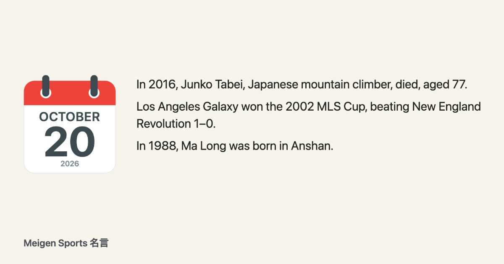</picture></a></p>

<h1 align="center">Meigen Sports <sub>名言</sub></h1>

<p align="center"><strong>Source-verified sports quotations and dated events in sports history.</strong><br>
A typed data package with one small runtime dependency, koyomi-calendars, for the calendar icons. Read the included data offline, filter it by date, sport or source, or load versioned static JSON feeds. MIT code; source data keeps its own rights.</p>

<p align="center">
  <a href="https://github.com/johnmorrisdotca/meigen-sports/actions/workflows/ci.yml"></a>
  <a href="https://www.npmjs.com/package/@johnmorrisdotca/meigen-sports"></a>
  <a href="./LICENSE"></a>
  <a href="./NOTICE.md"></a>
  
  
</p>

<p align="center"><a href="https://johnmorrisdotca.github.io/meigen-sports/"><strong>Open the demo →</strong></a> · <a href="./NOTICE.md">Sources</a> · <a href="./docs/record-schema.md">Record schema</a> · <a href="./docs/templates.md">Templates</a> · <a href="./docs/categories.md">History tags</a> · <a href="./docs/history-model.md">History model</a> · <a href="./docs/data-pipeline.md">Pipeline</a> · <a href="./docs/demo.md">The demo in pictures</a> · <a href="./docs/calendar-gallery.md">Calendar gallery</a> · <a href="./docs/calendar-icons.md">Calendar icons</a> · <a href="./docs/display-layouts.md">Layouts</a> · <a href="./docs/uses.md">Uses</a></p>

<p align="center">
<picture>
<source media="(prefers-color-scheme: dark)" srcset="https://raw.githubusercontent.com/johnmorrisdotca/meigen-sports/main/docs/images/hero-icons-dark.webp">
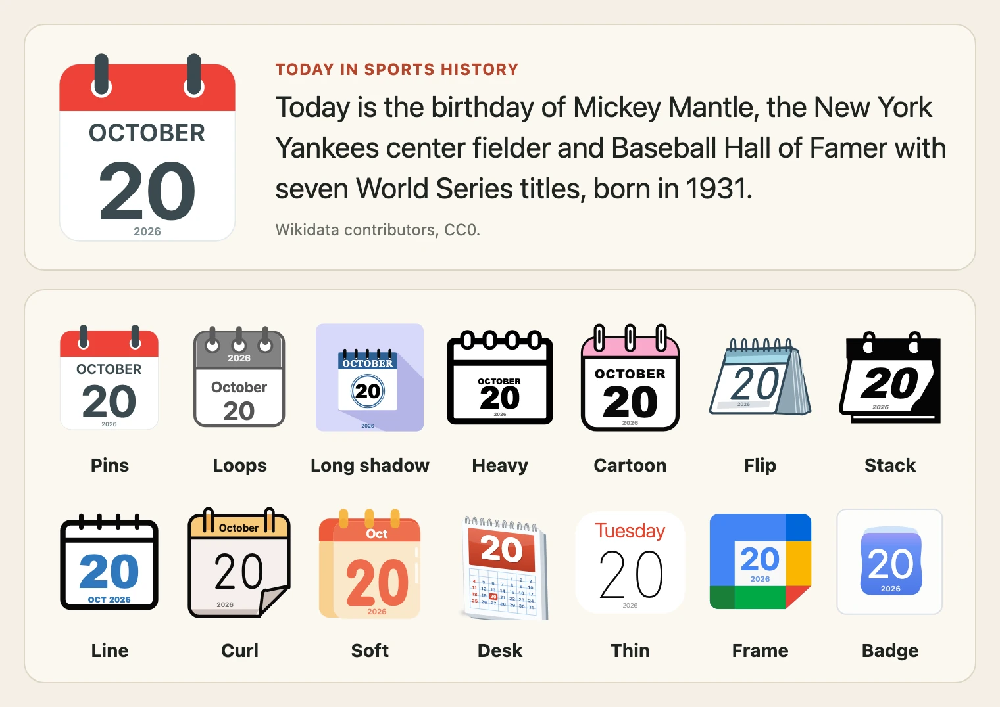
</picture>
<br><em>A today card, and the eighteen calendar pages, all drawn by <code>calendarIcon</code>: the same fact on October 20.</em>
</p>

## The best of it

The pictures of calendar pages, layouts, cards, banners and sports are drawn by the package's own functions (`pnpm images:showcase` draws them again), each in light and dark.

- **Eighteen calendar pages** (`calendarIcon`): pins, loops, long shadow, heavy, cartoon, flip, stack, line, curl, soft, desk, thin, frame, badge, squircle, and the three tear-off pages sun disc, wall roll and plain (with a weekend page of a Saturday and a Sunday on one page, `calendarWeekend`, and a moon phase, `calendarMoon`), each in light and dark, in English and Japanese, from 16 to 1024 pixels wide. [Every theme at every size and date](./docs/calendar-gallery.md) · [Gallery in Japanese](./docs/calendar-gallery.ja.md) · [how each is drawn](./docs/calendar-icons.md).

<p align="center">
<picture>
<source media="(prefers-color-scheme: dark)" srcset="https://raw.githubusercontent.com/johnmorrisdotca/meigen-sports/main/docs/images/themes-dark.webp">
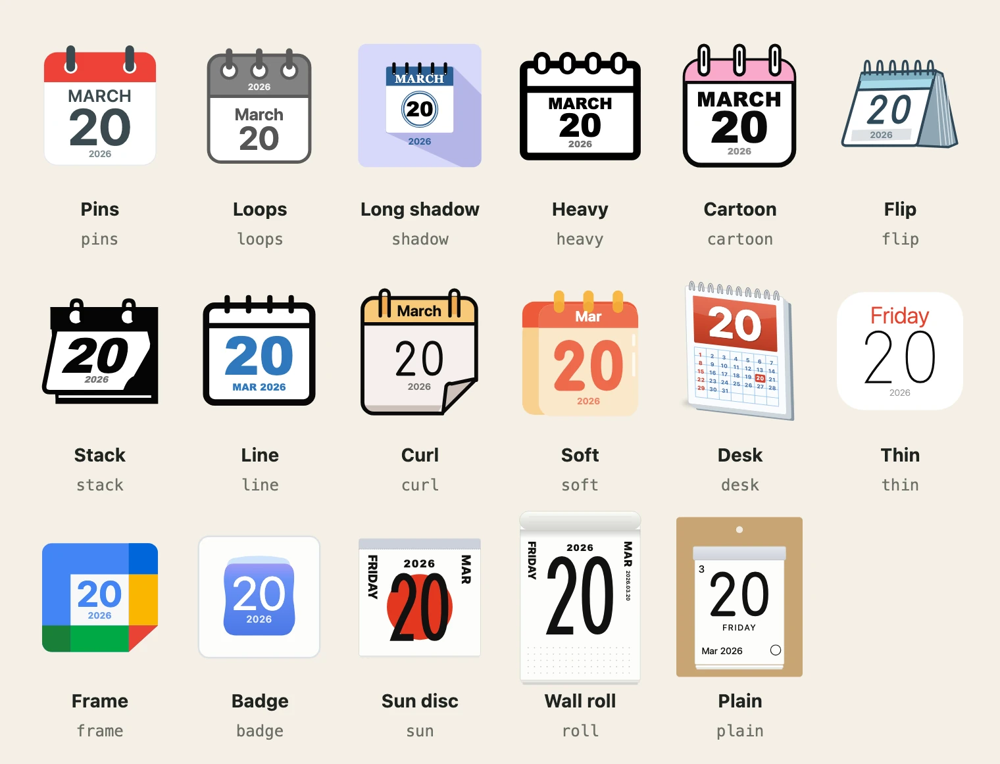
</picture>
<br><em>Eighteen themes, one call each.</em>
</p>

```js
import { CALENDAR_THEMES, calendarIcon } from "@johnmorrisdotca/meigen-sports";

const row = CALENDAR_THEMES.map((theme) => calendarIcon({ theme, month: 3, day: 20, year: 2026, scheme: "dark", size: 96 }));
console.log(row.length); // 18
console.log(CALENDAR_THEMES.join(" ")); // pins loops shadow heavy cartoon flip stack line curl soft desk thin frame badge sun roll plain squircle
```

- **Tear-off pages and weekend pages**: `sun`, `roll` and `plain` look like a day-by-day tear-off calendar, with the weekday, month and holiday in side columns (the holiday names are yours: `holidays`), a slot in the sun for any mark (`mark`), a moon phase on `plain`, and a Saturday and the Sunday after it on one page for `sun` and `roll` (`weekend: "split"`, `calendarWeekend`, `calendarMoon`). [How they work](./docs/calendar-icons.md#tear-off-pages-sun-roll-and-plain).

<p align="center">
<picture>
<source media="(prefers-color-scheme: dark)" srcset="https://raw.githubusercontent.com/johnmorrisdotca/meigen-sports/main/docs/images/tearoff-dark.webp">
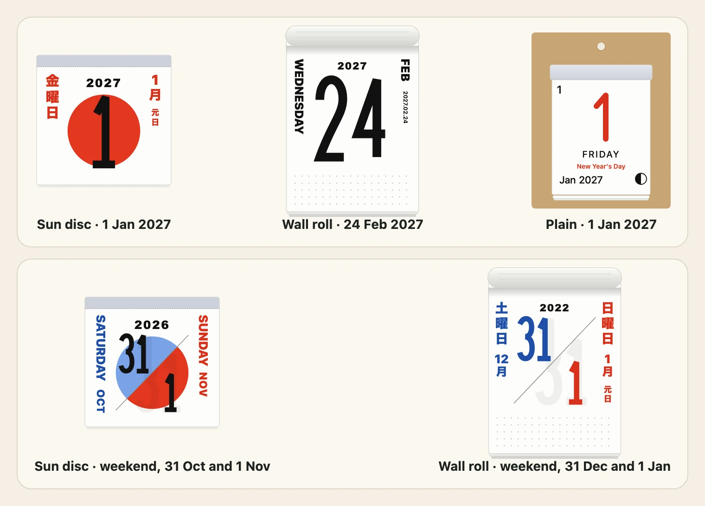
</picture>
<br><em>Three tear-off pages, and the weekend page of two of them.</em>
</p>

```js
import { calendarIcon, calendarWeekend } from "@johnmorrisdotca/meigen-sports";

const weekend = calendarWeekend(2026, 10, 31); // a Saturday: the Sunday is the next month
console.log(weekend?.sunday.month, weekend?.sunday.day); // 11 1
console.log(calendarIcon({ theme: "roll", month: 10, day: 31, year: 2026, weekend: "split" }).includes("Sunday Nov 1 2026")); // true
```

- **Four ways to lay out a day** (`displayMarkup`): a calendar card, a year list of events, births and deaths, a compact list, and one featured fact. The helpers return HTML; the optional `styles.css` colours it from the page ([layouts](./docs/display-layouts.md)).

<p align="center">
<picture>
<source media="(prefers-color-scheme: dark)" srcset="https://raw.githubusercontent.com/johnmorrisdotca/meigen-sports/main/docs/images/layouts-dark.webp">
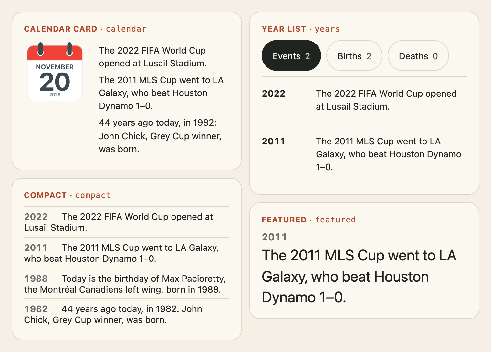
</picture>
<br><em>The four layouts over the same day.</em>
</p>

```js
import { DISPLAY_LAYOUTS, displayMarkup } from "@johnmorrisdotca/meigen-sports";

const items = [{ text: "The 2011 MLS Cup went to LA Galaxy, who beat Houston Dynamo 1–0.", year: "2011" }];
console.log(DISPLAY_LAYOUTS.join(" ")); // calendar years compact featured
console.log(displayMarkup({ layout: "featured", items }).includes("2011 MLS Cup")); // true
```

- **Today cards**: the day's facts, worded for the day they are read on, beside a calendar page in any theme and either language. `today` picks the day in the reader's time zone; the library never reads the clock.

<p align="center">
<picture>
<source media="(prefers-color-scheme: dark)" srcset="https://raw.githubusercontent.com/johnmorrisdotca/meigen-sports/main/docs/images/today-dark.webp">
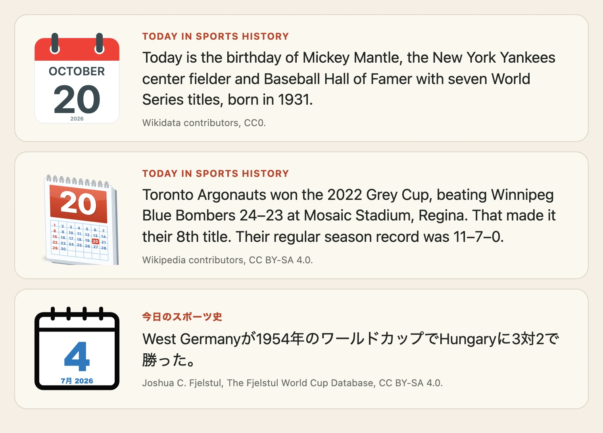
</picture>
<br><em>Three days, three themes, one in Japanese.</em>
</p>

```js
import { calendarDayInZone, calendarIcon, displayMarkup, renderRun, today } from "@johnmorrisdotca/meigen-sports";
import offline from "@johnmorrisdotca/meigen-sports/offline";

const now = "2026-10-20T15:00:00Z";
const [month, day] = calendarDayInZone("America/Toronto", now).split("-").map(Number);
const facts = renderRun(today(offline, "America/Toronto", now).slice(0, 3), { seed: "card", locale: "en", asOf: "2026-10-20" });
const card = displayMarkup({ layout: "calendar", icon: calendarIcon({ theme: "pins", month, day, year: 2026 }), items: facts.map((fact) => ({ text: fact.text })) });
console.log(month, day); // 10 20
console.log(facts.length, card.includes("meigen-cal")); // 3 true
```

- **Banners**: an icon beside one featured fact, as wide as the page. Two lines of your own CSS, no new API ([how](./docs/display-layouts.md#banners)).

<p align="center">
<picture>
<source media="(prefers-color-scheme: dark)" srcset="https://raw.githubusercontent.com/johnmorrisdotca/meigen-sports/main/docs/images/banners-dark.webp">
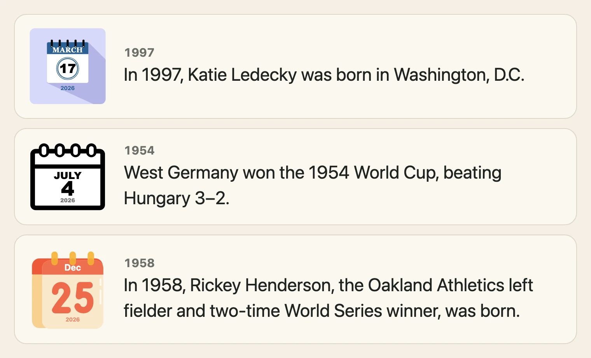
</picture>
<br><em>A banner is an icon and the featured layout.</em>
</p>

- **Facts by sport**: every sport has its own feed (`loadFactShard("feeds/sports/<sport>.json")`, 253 sports), one small file each, so a site fetches only the sports it shows. Cards of six of them, each drawn on the page of its own day:

<p align="center">
<picture>
<source media="(prefers-color-scheme: dark)" srcset="https://raw.githubusercontent.com/johnmorrisdotca/meigen-sports/main/docs/images/sports-dark.webp">
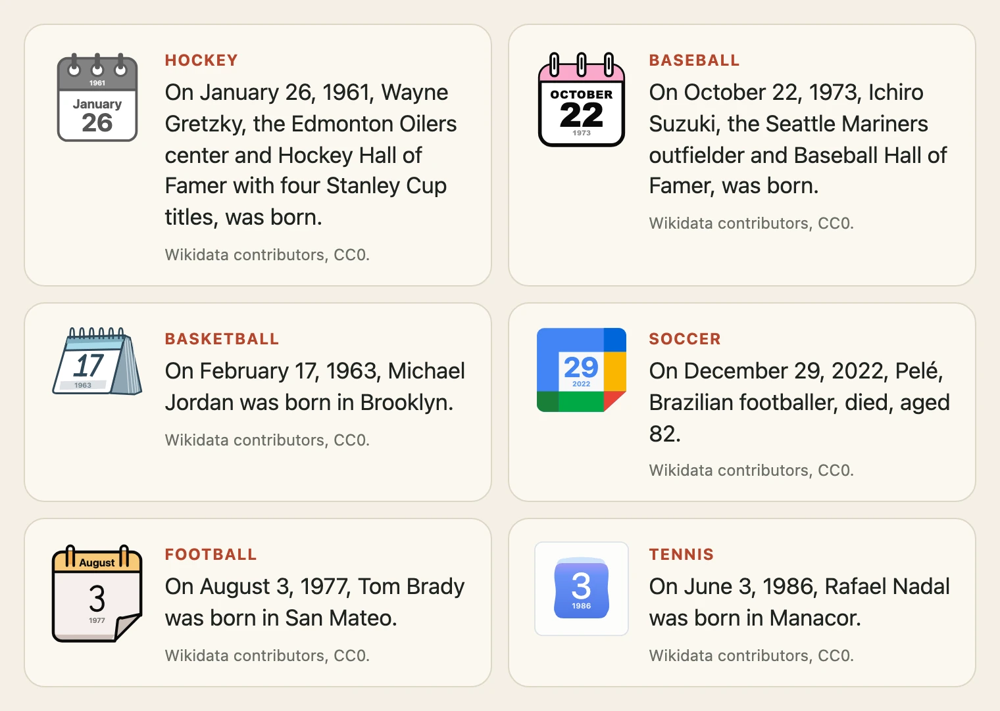
</picture>
<br><em>Hockey, baseball, basketball, soccer, football and tennis.</em>
</p>

- **Today in sports history**: 126,810 facts on all 366 calendar days, each with a sport, its people and teams, and its source. Among them are **44,570 births and deaths of sports people** in 146 sports, from the Wikidata dump (CC0), each with its Q id: a day's people are of every sport, not only the five leagues ([coverage of people](./docs/coverage-people.md)); and **28,205 events and competition editions** (the Olympic Games, World Cups, Grand Prix, Giro, Wimbledon and the rest: began, ended or took place on the day, with the place and the winner where Wikidata states them) ([coverage of events](./docs/coverage-events.md)); and **961 facts of para sports** (wheelchair basketball, tennis, curling and rugby, goalball, boccia, sitting volleyball, para athletics and swimming and the Paralympic Games: famous people and the editions and team results, with the sport's name only and never a class or a health word) ([para sports](./docs/para-sports.md)).

- **Birthdays, deaths and finals as sentences**, with the club and honours, the score and venue, the title and the season's record; neighbours in a list never share a template (`renderRun`). A fact read on a day that is not its own says its full date ("On July 4, 1945, …", "born on July 7, 1960"); "today" and "on this day" are for its own day only, and a missing value is never printed as "(none)".

- **An offline set in the package**: 1,525 facts, three to five for every day, so `today()` works with no network ([offline](#what-is-bundled-and-what-loads-from-pages)).

- **The Japanese calendar on a page**: `japaneseHoliday` and `japaneseHolidaysOf` (the public holidays, `JAPANESE_HOLIDAY_YEARS` 2000 to 2099, by the Act on National Holidays), `oldCalendarDate` (the old lunisolar calendar, `OLD_CALENDAR_YEARS` 1900 to 2100, from the new moon and the principal terms in Japan Standard Time) and `rokuyoOf` and `ROKUYO` (the six-day cycle) are computed from the date, never looked up, and a date they cannot settle is `null`; `calendarIcon({ japanese: true })` draws them in the side columns of `sun` and `roll` ([how, and when a cell stays empty](./docs/japanese-calendar.md)).
- **All-Star Games and baseball feats**: 335 All-Star Games (the NHL, NBA and MLB games, the Pro Bowl, the CFL game) with day, venue, score and most valuable players, and 290 no-hitters and perfect games counted from Retrosheet's game logs ("Don Larsen of the New York Yankees pitched a perfect game against the Brooklyn Dodgers, winning 2–0 in the World Series."); with 397 retired numbers (the NHL's named by the club of the day), `visualOf` says which banner and gear a fact may be drawn with.
- **Player feats**: 130 facts of five or more goals in an NHL game (64), the 500th NHL goal of each of the 50 players who scored one, and NBA games of 70 or more points (16), from English Wikipedia's complete lists, so "his 3rd game of five or more goals" is a count and never a guess ("On November 22, 1986, Wayne Gretzky of the Edmonton Oilers scored his 500th NHL goal into an empty net against the Canucks, in his 575th game.").
- **Tags for everything a fact is about, and a flag where it is unambiguous**: every fact carries `sport:handball`, `country:RO`, `decade:1990s`, `award:hart-memorial-trophy`, `honour:champion` and more in its `tags`, each built from a field the fact holds and never guessed ([the vocabulary and its counts](./docs/tags.md)). A person has the countries Wikidata gives (`countries`, ISO 3166), a `flag` code only when he represents one country, a `birthCountry`, and the titles of his Wikipedia articles (`wikipediaUrl` builds the address in the reader's language, English next, then Wikidata); a game of two teams of one country has its flag too (`flagOf`). `queryFacts({ country: "RO", day: "03-04" })` is the Romanian facts of a calendar day, from static indexes of ids; `findPeopleByName` finds a person by first or last name in one small file. No tag says sex, gender, ethnicity, religion, politics, family or health. The demo can draw a flag and the very trophy beside a fact (`trophy` names the emblem; [which awards have a likeness](./docs/tags.md#trophies)): `?flags=1&trophies=1`; the same switch hangs a retired number or a championship as a banner. `visualOf(fact)` says which banner (`retired` with its number, `title` with its year) and which dougu-sports `gear` (`GEAR_BY_SPORT`) goes with a fact, and draws nothing; a person's `jerseyNumber` is the tag `number:99`.
- **A date Wikidata itself disagrees about is marked, not hidden**: where Wikidata holds two or more equal-rank values for a birth or a death and names no preferred one, the fact keeps the date it had, says `dateDisputed: true`, lists the other days (`dateAlternatives`, and `birthDateAlternatives` / `deathDateAlternatives` for a date it only carries), carries the tag `date:disputed` and a short `dateNote`; 716 facts of 524 people. A sentence never says "today" unless every alternative falls on that month and day, and the demo shows a small "date disputed" marker with the other days in its tooltip. The list is [`data-sources/disputed-dates.json`](./data-sources/disputed-dates.json), made by `pipeline/audit_dates.py`.
- **Feeds by team, player, sport and tag**, and **the people and the events of each day across sports**: one small static file each, loaded with `loadFactShard` (`loadFactPeopleDay` for a day's people: up to forty births and deaths, at most three of one sport; `loadFactEventsDay` for its events, the same), so a site fetches only what it shows.

<p align="center">
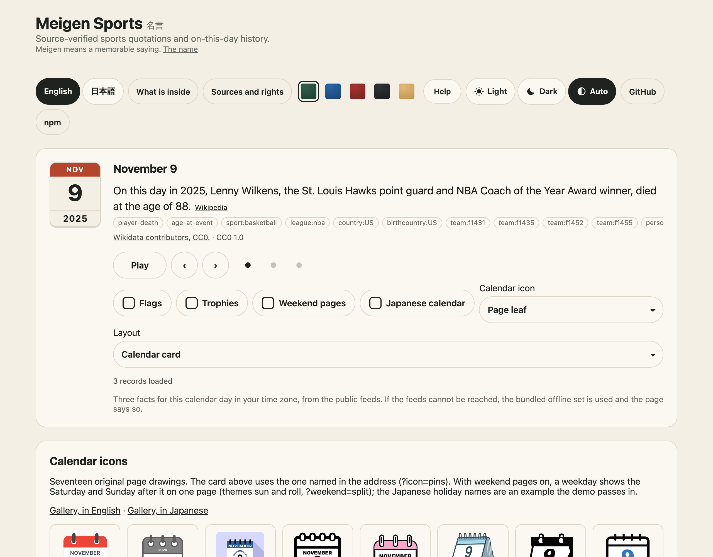
</p>

<table align="center">
<tr>
<td align="center" valign="top">
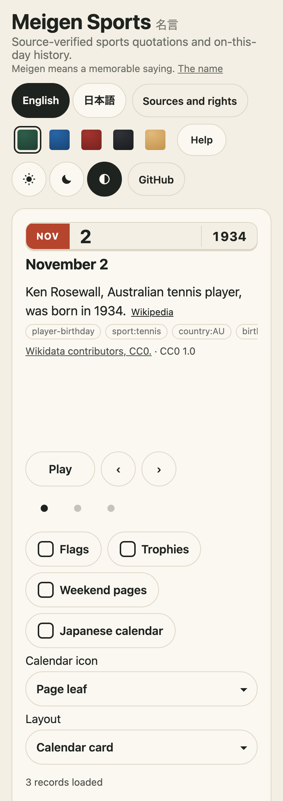<br><em>On a phone</em>
</td>
<td align="center" valign="top">
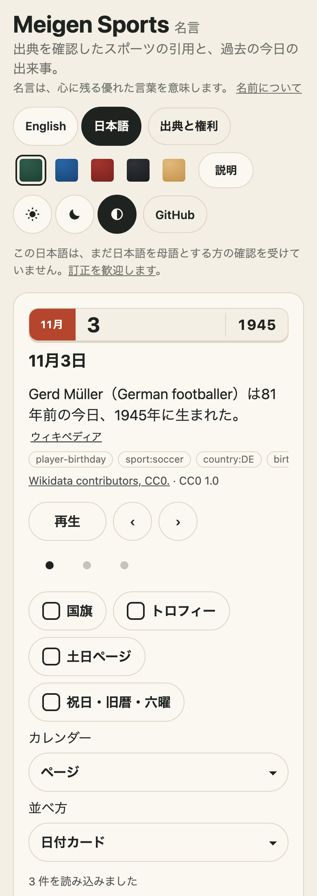<br><em>In Japanese</em>
</td>
</tr>
</table>

## In 30 seconds

Install the package and read the versioned data bundled with it:

```sh
npm install @johnmorrisdotca/meigen-sports
```

```js
import { historyOnDate, quoteForDate } from "@johnmorrisdotca/meigen-sports";
import history from "@johnmorrisdotca/meigen-sports/history";
import quotes from "@johnmorrisdotca/meigen-sports/quotes";

historyOnDate(history, "2022-11-20", { sports: ["soccer"] }).length; // 1
quoteForDate(quotes, "2026-10-14")?.speaker; // "James Dwight"
```

## What is bundled and what loads from Pages

One build ships both places. The package and the GitHub Pages site are made from the same facts, and `node scripts/check-build.ts` fails a release when they are not the same build (it compares the package version, the data folder and a SHA-256 of the facts manifest).

| | In the npm package, works offline | On GitHub Pages, needs a network |
| --- | --- | --- |
| On-this-day facts | **1,525 facts**: the best three to five for each of the 366 calendar days, chosen by significance and fame and varied by kind, sport, person and club (`@johnmorrisdotca/meigen-sports/offline`) | **126,810 facts** on all 366 days, in static JSON under `data/v1/0.1.0/facts/` (days, the people and the events of each day across sports, teams, players, leagues, sports, tags, 100 `store/` files that together hold every fact), read through the `load*` functions |
| Quotations | 30 (22 Gutenberg excerpts, 8 Wikiquote sports lines tagged `famous-quotes`) | the same 30 in `quotes.json` |
| History starter | 1,052 dated rows on 142 days (`@johnmorrisdotca/meigen-sports/history`; World Cup matches and Wikidata events), kept for compatibility | `all.json`, `days/`, `sports/`, `entities/` |

`today(offline, timeZone, nowIso)` always answers from the package. **The rest of the facts are not in the package: Pages must be reachable for them** (the package is about 1 MB packed; the full facts are about 200 MB). A site should load the feeds and fall back to the offline set when they cannot be reached, and say that it did; the demo does exactly that. `data/v1/latest.json` names the current build (`package`, `build`, `offlineRecords`, `factRecords`) and its manifests, so a site can check that the feeds it reads are the build its package was made with.

This is a sourced collection with coverage gaps, not a complete daily almanac: [docs/golden-facts.md](./docs/golden-facts.md) lists the famous facts the data must hold, and those it is known not to hold yet. Quotes have unknown utterance dates and are never assigned invented anniversaries.

## Who it is for

Use Meigen Sports in a site, app or research tool that needs cited historical sports text and dated sports events, with predictable selectors and no runtime database dependency. The API exposes original source links, rights information, stable entity IDs and date roles alongside each record.

## Features

- Source-verified quotations from three historical books and English Wikiquote sports pages, and dated sporting facts from Wikidata and openfootball.
- Deterministic quotation selection and explicit-date history filters; the library does not read the clock or choose randomly.
- Sport, entity, source, kind, type, language and text filters.
- Versioned static JSON shards for calendar days, sports and stable entities, validated by an explicit loader.
- Source rights and provenance travel with each row. The package's MIT code licence does not relicense its data. Source lifecycle and usage notes ship in `data-sources/sources.json` and `data-sources/README.md`.
- Initial coverage includes all 964 matches from 22 FIFA World Cup editions (1930–2022), plus 88 published Wikidata event facts (10 World Cup start/end rows merged into the same-day match). The included sample does not contain collected player milestones or world records.
- Eighteen original calendar-page drawings (`calendarIcon`, `CALENDAR_THEMES`, `CALENDAR_THEME_ALIASES`, `calendarWeekend`, `calendarMoon`): pins, loops, shadow, heavy, cartoon, flip, stack, line, curl, soft, desk, thin, frame, badge, sun, roll, plain and squircle; the ten names of 0.12 still work. Each names the date in the way its look does, in light or dark. Optional CSS lives at `@johnmorrisdotca/meigen-sports/styles.css`. See [docs/calendar-icons.md](./docs/calendar-icons.md).

## Moving pictures

Slow on purpose (half speed), and in a row only the centre one moves.

<p align="center">
<picture>
<source media="(prefers-color-scheme: dark)" srcset="https://raw.githubusercontent.com/johnmorrisdotca/meigen-sports/main/docs/images/centre-days-dark.webp">
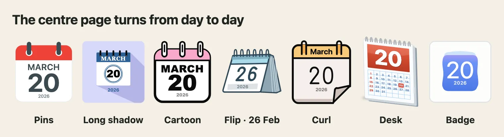
</picture>
<br><em>The centre page turns from day to day; the others stay.</em>
</p>

<p align="center">
<picture>
<source media="(prefers-color-scheme: dark)" srcset="https://raw.githubusercontent.com/johnmorrisdotca/meigen-sports/main/docs/images/centre-themes-dark.webp">
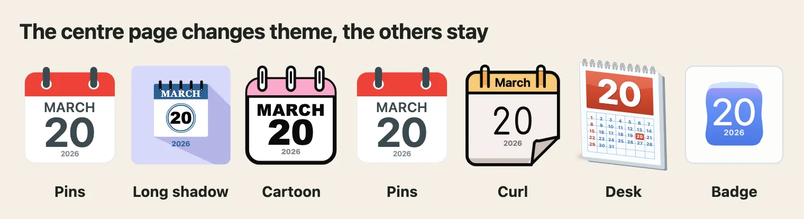
</picture>
<br><em>The centre page changes theme; the others stay.</em>
</p>

<p align="center">
<picture>
<source media="(prefers-color-scheme: dark)" srcset="https://raw.githubusercontent.com/johnmorrisdotca/meigen-sports/main/docs/images/hero-today-dark.webp">
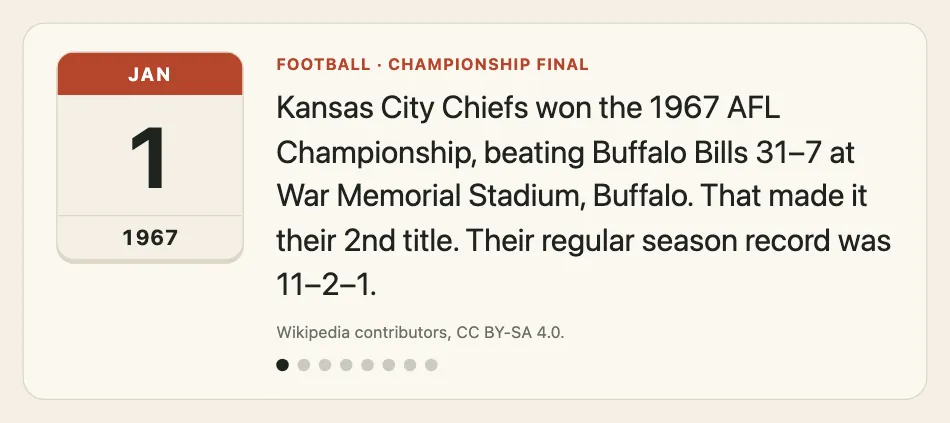
</picture>
<br><em>Today in sports history, a day at a time: 126,810 facts on all 366 days, each with its source.</em>
</p>

<p align="center">
<picture>
<source media="(prefers-color-scheme: dark)" srcset="https://raw.githubusercontent.com/johnmorrisdotca/meigen-sports/main/docs/images/sentences-dark.webp">
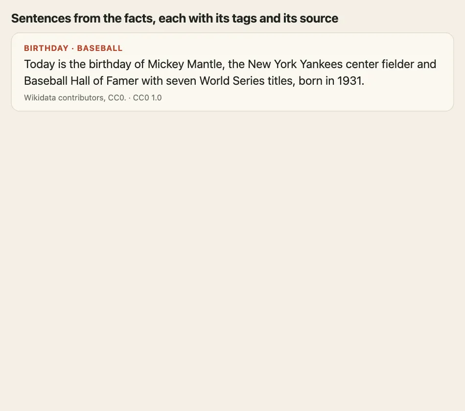
</picture>
<br><em>Four of the sentences the facts are worded into.</em>
</p>

<p align="center">
<picture>
<source media="(prefers-color-scheme: dark)" srcset="https://raw.githubusercontent.com/johnmorrisdotca/meigen-sports/main/docs/images/offline-dark.webp">
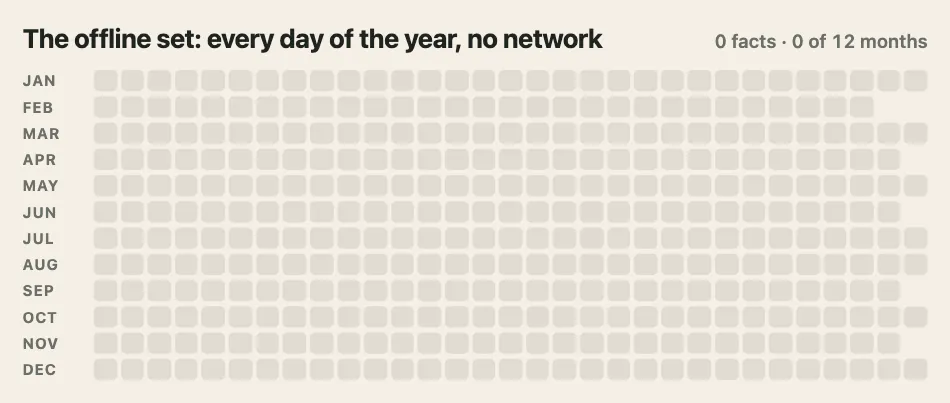
</picture>
<br><em>The bundled offline set, a month at a time.</em>
</p>

<p align="center">
<picture>
<source media="(prefers-color-scheme: dark)" srcset="https://raw.githubusercontent.com/johnmorrisdotca/meigen-sports/main/docs/images/feeds-dark.webp">
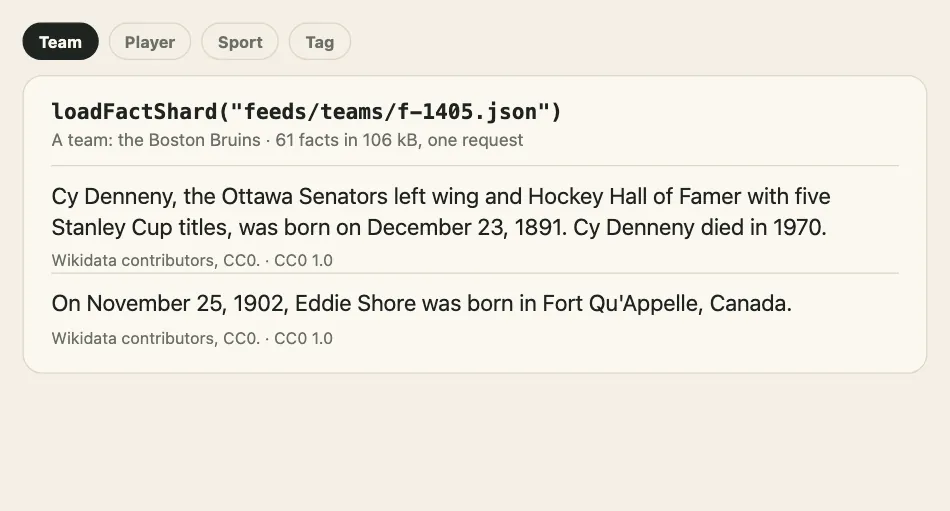
</picture>
<br><em>One request for each: a team, a player, a sport, a tag.</em>
</p>

## What is inside

Every number about the data is counted by the build from the facts themselves and written to [`catalogue.json`](https://johnmorrisdotca.github.io/meigen-sports/data/v1/0.1.0/catalogue.json) (in the package as `@johnmorrisdotca/meigen-sports/catalogue.json`, typed as `Catalogue`): the facts by kind, sport, league, decade, year and calendar day, the people (deceased, or "not known to be deceased", never "living"), the sources with their licences, the extracts the facts were made from with their checksums, the bundled offline set, and the **gaps**: the days, sports, leagues and decades that are thin, and what is partial or waiting. [The charts page](https://johnmorrisdotca.github.io/meigen-sports/catalogue.html) draws it, in English and Japanese, with each chart's numbers in a table behind it.

<p align="center">
<a href="https://johnmorrisdotca.github.io/meigen-sports/catalogue.html">
<picture>
<source media="(prefers-color-scheme: dark)" srcset="https://raw.githubusercontent.com/johnmorrisdotca/meigen-sports/main/docs/images/catalogue-dark.webp">
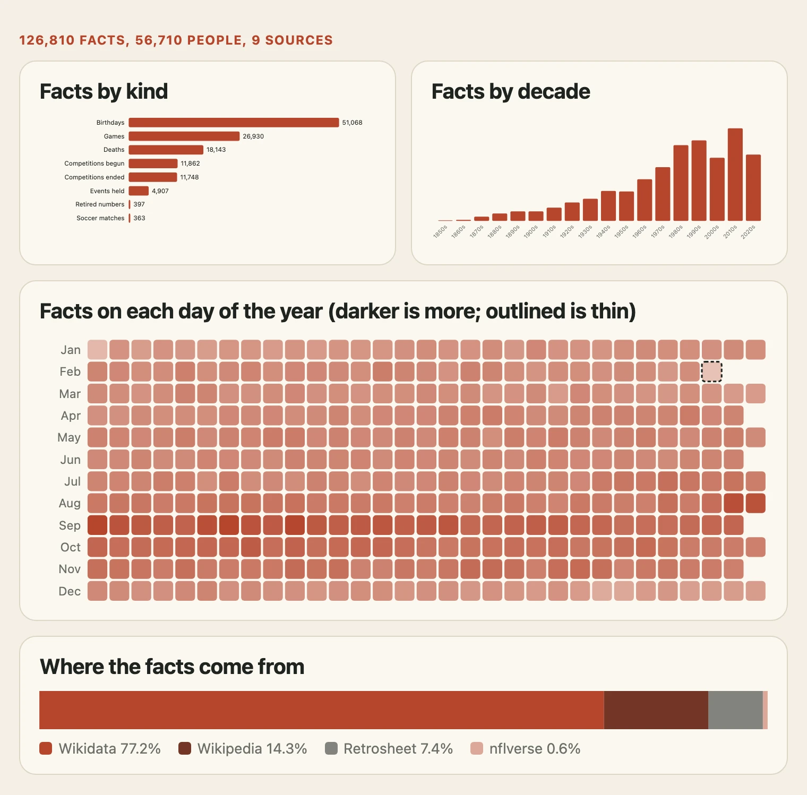
</picture>
</a>
<br><em>What is inside, counted by the build.</em>
</p>

## Use it in your project

```js
import { historyOnDate, selectRecords } from "@johnmorrisdotca/meigen-sports";
import history from "@johnmorrisdotca/meigen-sports/history";

const soccerHistory = historyOnDate(history, "11-20", { sports: ["soccer"] });
const openfootballOnly = selectRecords(soccerHistory, { includeSources: ["openfootball"] });
```

`date` accepts an exact `YYYY-MM-DD` or a calendar `MM-DD`. An exact date also excludes later records. Empty results are possible and expected where the current dataset has no coverage.

To load a public static shard, supply its base URL, data version and fetch function. The path is appended as `data/v1/<version>/...`; no database credentials or endpoint are involved.

```js no-run
import { loadDay } from "@johnmorrisdotca/meigen-sports/load";

const day = await loadDay("11-20", {
  baseUrl: "https://johnmorrisdotca.github.io/meigen-sports/",
  dataVersion: "0.1.0",
  fetch: globalThis.fetch,
});
day.records.length; // 2
```

The network example is not run by the README check; [docs/status.md](./docs/status.md) says what is published and what is still being completed.

A sentence is worded for the day it is read on. Give `render` the day being shown (`asOf`, never read from the clock): on the fact's own day it may say "today" and "on this day" and keeps the year; on any other day, and with no `asOf`, it says the full date at the precision the record holds.

```js
import { render } from "@johnmorrisdotca/meigen-sports";

const team = (name) => ({ name, franchiseId: null, teamSeasonId: null, soccerTeamId: null, countryCode: "US", fifaCode: null, flagCode: null });
const game = {
  recordId: "example:game", category: "game-on-day", tags: [], basis: "source", eventDate: "1945-07-04", datePrecision: "day",
  sport: "baseball", competition: "mlb", league: "mlb", homeScore: 16, awayScore: 4,
  home: team("Pittsburgh Pirates"), away: team("New York Giants"), source: { sourceId: "example", licence: "CC0 1.0", attribution: "Example", url: null },
};
console.log(render(game, { asOf: "2026-10-20" }).text); // On July 4, 1945, Pittsburgh Pirates beat New York Giants 16–4 (MLB).
console.log(render(game, { asOf: "2026-07-04" }).text); // Pittsburgh Pirates beat New York Giants 16–4 (MLB, 1945).
console.log(render(game, { asOf: "2026-10-20", locale: "ja" }).text); // 1945年7月4日、Pittsburgh PiratesがNew York Giantsに16対4で勝利した（MLB）。
```

A calendar page is drawn as SVG. Pass the month, day and year; the library never reads the clock.

```js
import { CALENDAR_THEMES, calendarIcon, calendarThemeOf } from "@johnmorrisdotca/meigen-sports";
console.log(CALENDAR_THEMES.length); // 18
console.log(calendarThemeOf("classic")); // pins
console.log(calendarIcon({ month: 3, day: 20, year: 2026, theme: "pins" }).includes("2026")); // true
```

A day's facts can be laid out four ways. The helper returns HTML; the optional stylesheet colours it from the page.

```js
import { displayLayoutOf, displayMarkup } from "@johnmorrisdotca/meigen-sports";
console.log(displayLayoutOf("years")); // years
console.log(displayMarkup({ layout: "featured", items: [{ text: "A fact", year: "1995" }] }).includes("1995")); // true
```

## Use it anywhere

The demo is [live on GitHub Pages](https://johnmorrisdotca.github.io/meigen-sports/), the [documentation site](https://johnmorrisdotca.github.io/meigen-sports/docs/) has a page for every export and for each way of using the package, in English and in Japanese, and the [embed page](https://johnmorrisdotca.github.io/meigen-sports/embed.html) is made for an `<iframe>`. Every example below and in the guides is a file in [`examples/`](./examples) that `pnpm test:usage` builds or runs against the package as npm packs it, and opens in a browser.

| How | Guide |
|---|---|
| A script tag from jsDelivr or unpkg | [Plain HTML and CDNs](./docs/guides/html-and-cdn.md) |
| An ES module in Vite or webpack | [Vite and webpack](./docs/guides/bundlers.md) |
| React, Vue, Svelte, Angular | [Frameworks](./docs/guides/frameworks.md) |
| An iframe of the embed page | [Embed it in an iframe](./docs/guides/embed-in-an-iframe.md) |
| TypeScript types, Node, a server | [TypeScript and Node](./docs/guides/typescript-and-node.md) |

On a server or in a script, the same functions run with no DOM and no clock:

```mjs
import { calendarIcon, displayMarkup, renderRun, today } from "@johnmorrisdotca/meigen-sports";
import offline from "@johnmorrisdotca/meigen-sports/offline";

// A server draws the same card a browser does: pure functions, no DOM, no clock (the caller says what "now" is).
const facts = renderRun(today(offline, "America/Toronto", "2026-10-20T15:00:00Z").slice(0, 3), { seed: "card", locale: "en", asOf: "2026-10-20" });
const card = displayMarkup({ layout: "calendar", icon: calendarIcon({ theme: "pins", month: 10, day: 20, year: 2026 }), items: facts.map((fact) => ({ text: fact.text })) });
const page = `<!doctype html><title>Sports history</title>${card}`;
console.log(facts.length, page.includes("meigen-cal"));
```

In a page, an iframe of the embed page needs no code of your own; the address chooses the day (`date`), the calendar page (`theme`), the language (`lang`), the layout (`layout`) and the sport (`sport`):

```html
<!doctype html>
<html lang="en">
  <head>
    <meta charset="utf-8" />
    <meta name="viewport" content="width=device-width, initial-scale=1" />
    <title>Meigen Sports in an iframe</title>
  </head>
  <body>
    <iframe
      src="https://johnmorrisdotca.github.io/meigen-sports/embed.html?date=10-20&theme=pins&lang=en"
      title="Sports history for October 20"
      width="420"
      height="360"
      loading="lazy"
      style="border: 0"
    ></iframe>
  </body>
</html>
```

In React, a component is the same few lines (Vue, Svelte and Angular are in the [frameworks guide](./docs/guides/frameworks.md)):

```tsx
import { calendarDayInZone, calendarIcon, displayMarkup, renderRun, today } from "@johnmorrisdotca/meigen-sports";
import offline from "@johnmorrisdotca/meigen-sports/offline";

export function TodayCard({ now = "2026-10-20T15:00:00Z", timeZone = "America/Toronto" }: { now?: string; timeZone?: string }) {
  const [month, day] = calendarDayInZone(timeZone, now).split("-").map(Number);
  const facts = renderRun(today(offline, timeZone, now).slice(0, 3), { seed: "card", locale: "en", asOf: now.slice(0, 10) });
  const html = displayMarkup({ layout: "calendar", icon: calendarIcon({ theme: "pins", month, day, year: 2026 }), items: facts.map((fact) => ({ text: fact.text })) });
  // displayMarkup escapes every fact's text, so its string is safe to set as HTML.
  return <div dangerouslySetInnerHTML={{ __html: html }} />;
}
```

## Examples

The snippets under **In 30 seconds** and **Use it in your project** are run by `pnpm test:readme` against the built package. A network load of the public feed is marked `no-run` until Pages is serving that version.

## API

The root export provides `isDate`, `monthDayOf`, `selectRecords`, `historyOnDate`, `quoteForDate`, `EXTRACT_CATEGORIES`, `FACT_CATEGORIES`, on-this-day helpers (`factsFor`, `today`, `calendarDayInZone`, `rankFeed`, `rankRecords`, `rankDay`, `bestOfDay`, `significance`, `randomFacts`, `tagsOf`, `kindTagsOf`, `uniqueRecordIds`, `withCaptions`, `captionFromFact`, `isRichFact`, `dayContext`, `factDate`, `dateNote`, `cleanLabel`; how lists are ranked and capped: [docs/ranking.md](./docs/ranking.md)), tags and links (`derivedTags`, `countriesOf`, `flagOf`, `slugOf`, `tagValues`, `isNamespaced`, `TAG_NAMESPACES`, `NAMESPACED_TAG`, `VALID_TAG`, `wikipediaUrl`, `wikipediaPageUrl`; [docs/tags.md](./docs/tags.md)), caption templates (`render`, `renderHistory`, `renderRun`, `templatesFor`, `TEMPLATES`, `TEMPLATE_TYPES`; `renderRun` words a list so that neighbours never repeat; `LEAGUE_LABEL` is the name a sentence gives a league code, `NHL` or `National Association`), same-event merge (`mergeHistoryEvents`, `finalCaptionFromMatch`, `uniqueHistoryIds`), calendar-page drawings (`calendarIcon`, `calendarThemeOf`, `CALENDAR_THEMES`, `CALENDAR_THEME_LABELS`; [docs/calendar-icons.md](./docs/calendar-icons.md)), display layouts (`displayMarkup`, `displayLayoutOf`, `displayKind`, `DISPLAY_LAYOUTS`, `DisplayItem`, `DisplayKind`, `DisplayLabels`, `DisplayLayout`, `DisplayOptions`; [docs/display-layouts.md](./docs/display-layouts.md)), the core record and feed types, on-this-day consume types (`OnThisDayRecord`, `TeamRef`, `PersonRef`), and `SCHEMA_VERSION` and `VERSION`.

| Import | Contents |
| --- | --- |
| `@johnmorrisdotca/meigen-sports` | Date helpers, deterministic selectors and public types |
| `@johnmorrisdotca/meigen-sports/quotes` | Bundled quotation records |
| `@johnmorrisdotca/meigen-sports/history` | Bundled dated history records (the starter) |
| `@johnmorrisdotca/meigen-sports/offline` | `offline`, the best three to five facts for every calendar day, and `OFFLINE_BUILD`, the build they were chosen from |
| `@johnmorrisdotca/meigen-sports/load` | `loadShard`, `loadDay`, `loadSport`, `loadEntity`, the facts loaders (`loadFactDay`, `loadCountry`, `queryFacts`, `queryFactIds`, `loadFactsById`, `findPeopleByName`, `loadVocabulary`, `loadTeamPicker`) and loader types |
| `@johnmorrisdotca/meigen-sports/categories` | `HISTORY_TYPES` and its evidence/readiness descriptions |
| `@johnmorrisdotca/meigen-sports/styles.css` | Optional rules for a `calendarIcon` SVG (`.meigen-cal`) and the four fact layouts |

The shapes of a record (`MeigenRecord`, `OnThisDayRecord`, `PersonRef`, `TeamRef`) and the 46 history tags are in [docs/record-schema.md](./docs/record-schema.md) and [docs/categories.md](./docs/categories.md): one fact is stored once and may carry several tags, and an entity label is never an identity key.

## Limits

The current feed is sparse: 224 calendar month-days have no history facts. Source coverage and eligible dates are recorded in [data-sources/coverage.json](./data-sources/coverage.json). The collection contains historical book excerpts, Wikiquote sports quotations (CC BY-SA 4.0), 88 published Wikidata event facts and 964 openfootball World Cup match results. It makes no comprehensive player, franchise or world-record claims.

What the current API does not yet expose (the record progression, all source evidence, automatic population from the sports database) is in [docs/coverage.md](./docs/coverage.md).

## Theming

Calendar pages are original SVG from `calendarIcon`. Optional layout rules ship as `@johnmorrisdotca/meigen-sports/styles.css`. The demo follows the family's cloth switch (`demo/family.css`) and keeps the chosen theme in `?icon=`.

## Accessibility

Quotations are in a `blockquote`. Each record's source is a real link with its licence. The demo's header language switch and help switch are the family's. Nothing in the library moves or plays a sound.

## Browser and runtime support

Any current browser, and Node 22 or later; also Deno, Bun, a worker and an edge function. Static loading takes the caller's `fetch`. [docs/status.md](./docs/status.md) has the CI matrix.

## Languages

The package data and source quotations are in English. The demo and data/history documentation are available in English and Japanese; the public library labels and historical text remain in their source language.

## Roadmap

- Complete raw archive backup, review and curated static-feed publication.
- Expand history coverage from evidence-backed sources and validated database extracts.
- Finish review of the demo, then complete package, README and browser checks.
- Add a versioned schema before publishing richer player or record-progression fields.

## Architecture

The package keeps TypeScript code, bundled JSON and source material apart; raw source bytes live in the permanent archive, and curation and public release are still pending. [docs/data-pipeline.md](./docs/data-pipeline.md) has the whole account.

## The name

*Meigen* (名言, めいげん) means a saying or quotation. Meigen Sports pairs historical sports quotations with dated events in sports history.

## Where it comes from

Quotations from three historical books and English Wikiquote, dated facts from Wikidata, openfootball, Wikipedia and other open sources, each with its own licence: [NOTICE.md](./NOTICE.md) and [docs/open-sources.md](./docs/open-sources.md) have every source and its terms.

## The family

<!-- family:start (made by scripts/family-readme.mjs from scripts/family-template.mjs; change those, not this) -->
Meigen Sports is one of twenty-nine packages, each made for the same site, each at
[github.com/johnmorrisdotca](https://github.com/johnmorrisdotca). The code of every one is MIT.

- [Korokoro](https://github.com/johnmorrisdotca/korokoro) (コロコロ): dice, with notation, exact odds, real sounds and the dice of many games. [Demo](https://johnmorrisdotca.github.io/korokoro/).
- [Kyuubu](https://github.com/johnmorrisdotca/kyuubu) (キューブ): a turning cube for the browser, 2×2 to 7×7, with record solves to replay. [Demo](https://johnmorrisdotca.github.io/kyuubu/).
- [Hitotsu](https://github.com/johnmorrisdotca/hitotsu) (一つ): a colour-card shedding game for two to eight, with the house rules people play. [Demo](https://johnmorrisdotca.github.io/hitotsu/).
- [Toranpu](https://github.com/johnmorrisdotca/toranpu) (トランプ): a deck of playing cards, card games with computer players, and solitaires. [Demo](https://johnmorrisdotca.github.io/toranpu/).
- [Tane](https://github.com/johnmorrisdotca/tane) (種): seeded random numbers and daily seeds, the same in every browser and on every server. [Demo](https://johnmorrisdotca.github.io/tane/).
- [Narabe](https://github.com/johnmorrisdotca/narabe) (並べ): one rules engine for abstract board games, from gomoku and Reversi to Go and checkers. [Demo](https://johnmorrisdotca.github.io/narabe/).
- [Tenka](https://github.com/johnmorrisdotca/tenka) (天下): world conquest for two to six, on a map of the real world. [Demo](https://johnmorrisdotca.github.io/tenka/).
- [Kumimoji](https://github.com/johnmorrisdotca/kumimoji) (組み文字): a crossword tile race, in English and Japanese kana. [Demo](https://johnmorrisdotca.github.io/kumimoji/).
- [Tsunagi](https://github.com/johnmorrisdotca/tsunagi) (繋ぎ): a line-joining logic puzzle whose every level has exactly one answer. [Demo](https://johnmorrisdotca.github.io/tsunagi/).
- [Jarajara](https://github.com/johnmorrisdotca/jarajara) (ジャラジャラ): mahjong tiles drawn as SVG, stacked layouts, and the matching solitaire Awase. [Demo](https://johnmorrisdotca.github.io/jarajara/).
- [Suido](https://github.com/johnmorrisdotca/suido) (水道): a pipe puzzle: turn the pieces until the water reaches every drain. [Demo](https://johnmorrisdotca.github.io/suido/).
- [Domino](https://github.com/johnmorrisdotca/domino) (ドミノ): dominoes and Mexican Train. [Demo](https://johnmorrisdotca.github.io/domino/).
- [Kotoba](https://github.com/johnmorrisdotca/kotoba) (言葉): word lists and word-game rules in English, French, German and Japanese. [Demo](https://johnmorrisdotca.github.io/kotoba/).
- [Sugoroku](https://github.com/johnmorrisdotca/sugoroku) (双六): backgammon and its variants, with the doubling cube and match play. [Demo](https://johnmorrisdotca.github.io/sugoroku/).
- [Kazu](https://github.com/johnmorrisdotca/kazu) (数): grid number puzzles: Sudoku and its variants, Futoshiki and Skyscrapers. [Demo](https://johnmorrisdotca.github.io/kazu/).
- [Meikyuu](https://github.com/johnmorrisdotca/meikyuu) (迷宮): mazes on squares, hexagons, triangles and circles, made from a seed and drawn through with a finger or the mouse. [Demo](https://johnmorrisdotca.github.io/meikyuu/).
- [Hikidashi](https://github.com/johnmorrisdotca/hikidashi) (引き出し): a drawer of small Japanese text tools: era dates, kanji numerals, readings and sentence difficulty. [Demo](https://johnmorrisdotca.github.io/hikidashi/).
- [Chizu](https://github.com/johnmorrisdotca/chizu) (地図): maps of the world and of countries' regions, in English and Japanese, with a quiz and callouts. [Demo](https://johnmorrisdotca.github.io/chizu/).
- [Bushu](https://github.com/johnmorrisdotca/bushu) (部首): find a kanji by the parts it is made of. [Demo](https://johnmorrisdotca.github.io/bushu/).
- [Tobiishi](https://github.com/johnmorrisdotca/tobiishi) (飛び石): peg solitaire with nine boards and seeded solvable challenges. [Demo](https://johnmorrisdotca.github.io/tobiishi/).
- [Jirai](https://github.com/johnmorrisdotca/jirai) (地雷): minesweeper on shaped grids with verified no-guess boards. [Demo](https://johnmorrisdotca.github.io/jirai/).
- [Gunjin](https://github.com/johnmorrisdotca/gunjin) (軍人): five hidden-rank strategy games with pass-the-device play. [Demo](https://johnmorrisdotca.github.io/gunjin/).
- [Karakuri](https://github.com/johnmorrisdotca/karakuri) (からくり): eight hyper-casual puzzle games, some of them physics: draw a shield, pull pins, cut ropes, slide blocks, pour tubes. [Demo](https://johnmorrisdotca.github.io/karakuri/).
- [Houseki](https://github.com/johnmorrisdotca/houseki) (宝石): gem and stone matching puzzles: falling triplets, stone collapse, colour chains and gem swap. [Demo](https://johnmorrisdotca.github.io/houseki/).
- [Kyogijo Stadiums](https://github.com/johnmorrisdotca/kyogijo-stadiums) (競技場): sports fields, rinks, courts and ballparks drawn to scale as SVG, with each team and the score on them. [Demo](https://johnmorrisdotca.github.io/kyogijo-stadiums/).
- [Taisen Brackets](https://github.com/johnmorrisdotca/taisen-brackets) (対戦): a sport-agnostic tournament bracket, drawn as SVG, from a list of ties. [Demo](https://johnmorrisdotca.github.io/taisen-brackets/).
- [Dougu Sports](https://github.com/johnmorrisdotca/dougu-sports) (道具): sports emblems as SVG: trophies, medals, crests, and the ball and gear of every sport, with optional 3D turning. [Demo](https://johnmorrisdotca.github.io/dougu-sports/).
- [Senshu Jerseys](https://github.com/johnmorrisdotca/senshu-jerseys) (選手): sports jerseys, sweaters, kits, caps, helmets and retired-number banners as SVG, front and back, with optional 2.5D turning. [Demo](https://johnmorrisdotca.github.io/senshu-jerseys/).
- [Meigen Sports](https://github.com/johnmorrisdotca/meigen-sports) (名言): sports quotations and on-this-day history. [Demo](https://johnmorrisdotca.github.io/meigen-sports/). Not on npm yet.

**This package is Meigen Sports.** The demos of all twenty-nine share one header and footer, so each links the rest.
<!-- family:end -->

## Development

```sh
pnpm install
pnpm check          # lint, types, tests, the build and the packed package
pnpm dev            # the demo on http://127.0.0.1:7400/
pnpm test:demo      # the demo in a real browser
pnpm test:readme    # the README's and the docs' examples
pnpm screenshots    # retake the README's demo pictures
pnpm images:showcase # redraw the calendar, layout, gallery and moving pictures
```

This package owns local ports 7400 to 7499 (see [CONTRIBUTING.md](./CONTRIBUTING.md)).

## Contributing

Bug reports and ideas go in the [issues](https://github.com/johnmorrisdotca/meigen-sports/issues); read [CONTRIBUTING.md](./CONTRIBUTING.md) first.

## Changes

See [CHANGELOG.md](./CHANGELOG.md).

## Credits

Every source is credited in [NOTICE.md](./NOTICE.md), with original notices in [LICENSES/](./LICENSES/).

## Licence

The code is [MIT](./LICENSE). Source data keeps its own licence, named in [NOTICE.md](./NOTICE.md), with its text in [LICENSES/](./LICENSES/).
