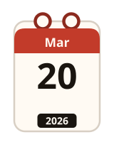
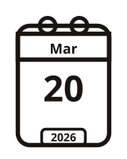
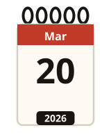
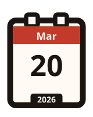
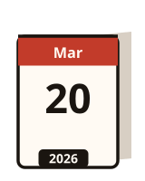
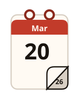
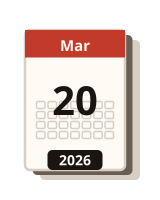
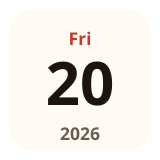
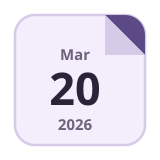
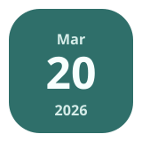

# Calendar icons

Ten original calendar-page drawings. Each is SVG from `calendarIcon`. No photograph, stock icon or product art is used, and no theme is named after a company.

| Id | English | Japanese | Picture |
| --- | --- | --- | --- |
| `classic` | Classic | クラシック |  |
| `outline` | Outline | 線画 |  |
| `spiral` | Spiral | スパイラル綴じ |  |
| `bold` | Bold | 太枠 |  |
| `tent` | Tent | 卓上 |  |
| `curl` | Curl | めくり |  |
| `pad` | Pad | 日めくり |  |
| `minimal` | Minimal | ミニマル |  |
| `fold` | Fold | 折り角 |  |
| `tile` | Tile | タイル |  |

The Japanese names have not yet been read by a person who reads Japanese.

```js no-run
import { calendarIcon } from "@johnmorrisdotca/meigen-sports";
import "@johnmorrisdotca/meigen-sports/styles.css";

document.body.innerHTML = `<span class="meigen-cal">${calendarIcon({
  theme: "classic",
  month: 3,
  day: 20,
  year: 2026,
  locale: "en",
  scheme: "light",
})}</span>`;
```

Pass the month (1–12), the day (1–31) and an optional year. The library does not read the clock. `scheme` is `light` or `dark`. `calendarThemeOf(name)` returns a theme id or `null`.

The demo keeps the choice in the address: `?icon=classic`.
