# Calendar icons

[Gallery of every theme at several sizes and dates](calendar-gallery.md) · [The gallery in Japanese](calendar-gallery.ja.md) · [Layouts that use them](display-layouts.md)

<p align="center">
<picture>
<source media="(prefers-color-scheme: dark)" srcset="./images/hero-icons-dark.webp">
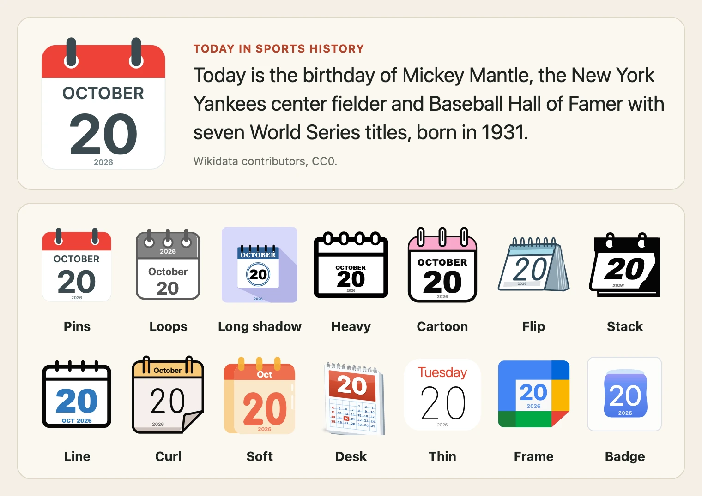
</picture>
</p>

Seventeen themes, one call each. The picture above is `calendarIcon` called once for each theme (light and dark are the same call with `scheme`).

```js
import { CALENDAR_THEMES, calendarIcon } from "@johnmorrisdotca/meigen-sports";

const svg = calendarIcon({ theme: "flip", month: 3, day: 20, year: 2026, locale: "en", scheme: "light", size: 96 });
console.log(svg.startsWith("<svg")); // true
console.log(svg.includes("Friday Mar 20 2026")); // true
console.log(CALENDAR_THEMES.length); // 17
```

## Examples

### Every theme, light and dark

<p align="center">
<picture>
<source media="(prefers-color-scheme: dark)" srcset="./images/themes-dark.webp">
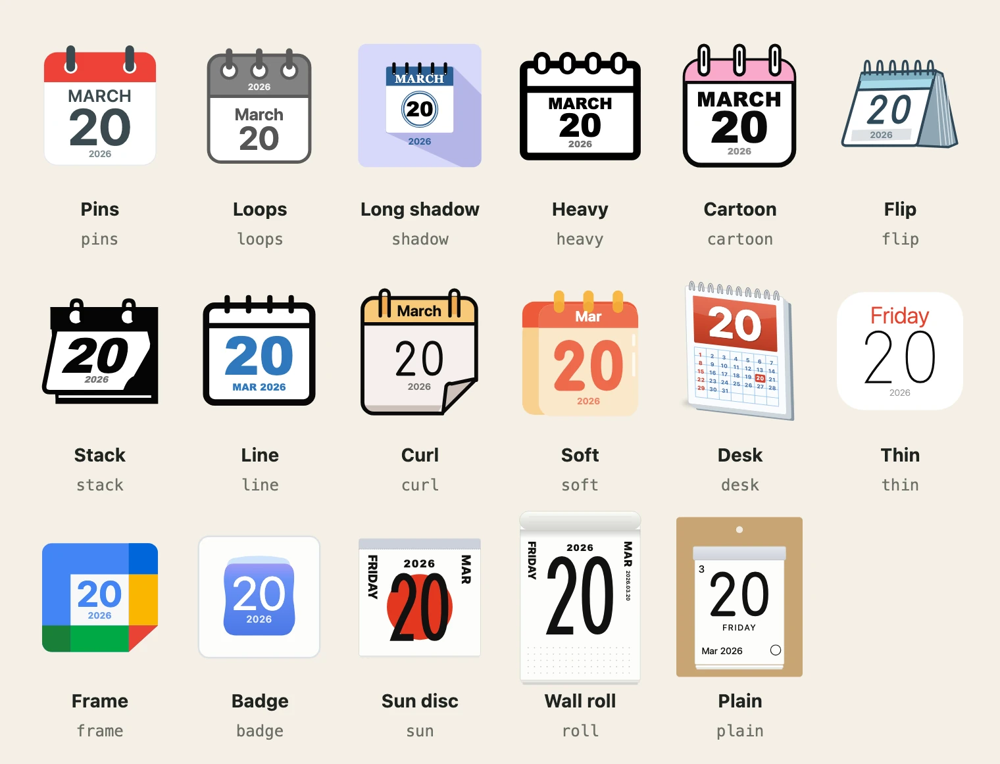
</picture>
</p>

```js
import { CALENDAR_THEMES, calendarIcon } from "@johnmorrisdotca/meigen-sports";

const light = CALENDAR_THEMES.map((theme) => calendarIcon({ theme, month: 3, day: 20, year: 2026, scheme: "light" }));
const dark = CALENDAR_THEMES.map((theme) => calendarIcon({ theme, month: 3, day: 20, year: 2026, scheme: "dark" }));
console.log(light.every((svg, at) => svg !== dark[at])); // true
```

### In Japanese

The month and the weekday follow `locale`. A theme that names the month draws `3月`; the weekday and the full date are in the `<title>`, in Japanese date order: `2026年3月20日（金曜日）` (2026, March 20, Friday), or `3月20日` (March 20) when no year is given.

```js
import { calendarIcon } from "@johnmorrisdotca/meigen-sports";

console.log(calendarIcon({ theme: "pins", month: 3, day: 20, year: 2026, locale: "ja" }).includes("<title>2026年3月20日（金曜日）</title>")); // true
console.log(calendarIcon({ theme: "pins", month: 3, day: 20, locale: "ja" }).includes("<title>3月20日</title>")); // true
```

<p align="center">
<picture>
<source media="(prefers-color-scheme: dark)" srcset="./images/themes-ja-dark.webp">
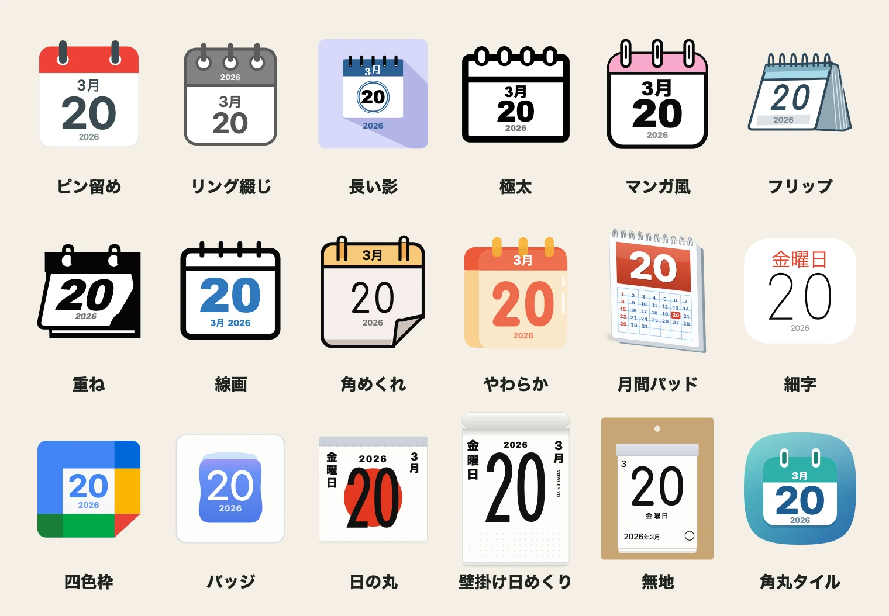
</picture>
</p>

```js
import { calendarIcon } from "@johnmorrisdotca/meigen-sports";

const svg = calendarIcon({ theme: "line", month: 9, day: 9, year: 2026, locale: "ja", scheme: "dark" });
console.log(svg.includes("2026年9月9日（水曜日）")); // true
```

### Sizes

`size` is the width in pixels, from 16 to 1024, and the height follows the theme's own shape. The [gallery](calendar-gallery.md) shows every theme from 16 to 96 pixels.

```js
import { calendarIcon } from "@johnmorrisdotca/meigen-sports";

const widths = [16, 32, 64, 128].map((size) => calendarIcon({ theme: "desk", month: 12, day: 31, size }).match(/ width="(\d+)"/)?.[1]);
console.log(widths.join(" ")); // 16 32 64 128
```

### With a year and without

A weekday is drawn only when a year is given, because without a year it would be a guess. Without one, a theme with room shows the month in its place.

```js
import { calendarIcon } from "@johnmorrisdotca/meigen-sports";

console.log(calendarIcon({ theme: "pins", month: 3, day: 20 }).includes("Friday")); // false
console.log(calendarIcon({ theme: "pins", month: 3, day: 20, year: 2026 }).includes("Friday")); // true
```

### Every date is drawn

All 366 days, both languages, light and dark, with and without a year, are drawn and checked for well-formed markup by `test/calendar-icon.test.ts`. 29 February is a real day here.

```js
import { CALENDAR_THEMES, calendarIcon } from "@johnmorrisdotca/meigen-sports";

const whole = CALENDAR_THEMES.every((theme) => calendarIcon({ theme, month: 2, day: 29, year: 2028 }).endsWith("</svg>"));
console.log(whole); // true
```

## The seventeen looks

Each is SVG from `calendarIcon`, drawn from shapes, gradients and a stroke-drawn digit set, so it looks the same on every device and needs no font file or picture. Each theme follows one of the looks John collected as references (a flat page with pins, a heavy black outline, a flip calendar, a thin large number and so on); the shapes are our own, no company's artwork is copied or shipped, no logo is used and no theme is named after a company or product.

| Id | English | Japanese | Picture | The look |
| --- | --- | --- | --- | --- |
| `pins` | Pins | ピン留め | 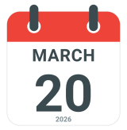 | a flat white page, a red header, two slate pins through white holes, the month in capitals and a large day |
| `loops` | Loops | 輪綴じ | 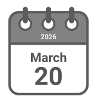 | a grey outline, a grey header and three ring pins |
| `shadow` | Long shadow | 長い影 | 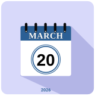 | a blue header, five black coils, a circled day and a long shadow on a lavender tile |
| `heavy` | Heavy | 極太 | 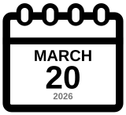 | a very heavy black outline, ring slots over the top edge and a black header rule |
| `cartoon` | Cartoon | マンガ風 | 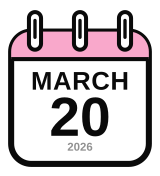 | a black cartoon outline, a pink header, white ring loops and a heavy word and number |
| `flip` | Flip | 卓上 | 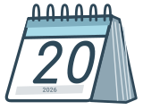 | a flip calendar in perspective: coils, a pale header, a slanted number and a fan of pages |
| `stack` | Stack | 重ね | 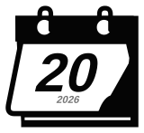 | a solid black glyph with a tilted white page, a curled corner and a sheet underneath |
| `line` | Line | 線画 | 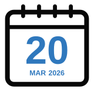 | black line art, four tick marks and a big blue number |
| `curl` | Curl | めくり | 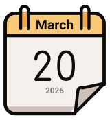 | line art with an orange header, two hooks, thin rounded digits and a curled corner |
| `soft` | Soft | やわらか | 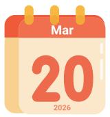 | a flat orange header, three amber rings, a cream page with a side shade and a rounded coral number |
| `desk` | Desk | 立体 |  | a desk pad seen at an angle: silver coils, a red banner with a white number and the month's dates |
| `thin` | Thin | 細字 | 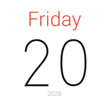 | a plain white page, the weekday in red and a very thin number |
| `frame` | Frame | 四色枠 | 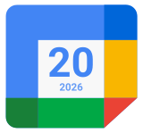 | four coloured sides round a pale square with a blue number and a folded corner |
| `badge` | Badge | バッジ | 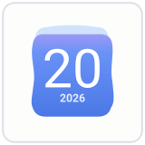 | a white tile with a soft blue page and a white number |
| `sun` | Sun disc | 日の丸 | 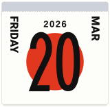 | a square tear-off page: a grey strip to tear it off by, a huge black day over a red disc, the year on top and a side column on each side |
| `roll` | Wall roll | 壁掛け | 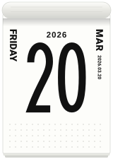 | a tall wall tear-off page: the pages already torn off curl above, a huge condensed day in the colour of its weekday, side columns and a dotted memo area |
| `plain` | Plain | 無地 | 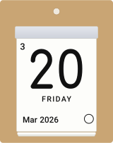 | a plain tear-off pad on a kraft stand: a small month, a big day, the weekday in capitals, the month and year, and the moon |

## What each drawing says

A theme draws what its look has room for. A theme whose look has a month word draws it in capitals (`MARCH`, or `3月`); one that has a weekday draws it only when a year is given (without a year a weekday would be a guess), and shows the month instead. A small year is drawn where the page has room. Whatever a theme leaves off the picture is in its `<title>` and `aria-label` (`Friday Mar 20 2026`; in Japanese `2026年3月20日（金曜日）`). A day the month does not have (30 February) is drawn as given and has no weekday.

## Where the day and the year sit

The day is centred in its page by default, the same for 1, 9, 30 and 31, and it is one size in a theme: a one-digit day is not drawn bigger than a two-digit one. Every theme says so in its own layout data (`numeral: "centre"`); a look that places its numerals elsewhere, as some real calendars do, has to say so there, apply it the same way to every day, and be listed here. The weekend page of `sun` and `roll` is the only one: it puts the two numerals on a diagonal (see [tear-off pages](#tear-off-pages-sun-roll-and-plain)). A day drawn as strokes (`flip`, `curl`, `soft`, `thin`) is centred by its ink; a day drawn as text is centred by its font, with a small move to the right when it ends in 1, because a font's 1 is narrow and sits left of its box.

The year chip has a minimum size, 7% of the drawing's width as a font size, and keeps at least 3% of the width between its bottom and the bottom of the room it sits in. When there is no year, the layout is drawn again, not left with the year's gap: the day, and the month word where the page has one, are centred as one block. `shadow` and `flip` also drop the year's room (the shadow tile's page moves to the middle, the flip page loses its year bar). `loops` keeps its year in the header, so its page has no gap either way, and `desk` has no year chip: its page shows the month's dates.

| Theme | The day | The year | With no year |
| --- | --- | --- | --- |
| `pins` | centred under the month | small line under the day | month and day centred |
| `loops` | centred under the month | in the header, between the rings and the rule | the header holds only the rings |
| `shadow` | centred in its circle | on the tile, under the page | the page moves to the middle of the tile |
| `heavy` | centred under the month | line under the day | month and day centred |
| `cartoon` | centred under the month | line under the day | month and day centred |
| `flip` | centred on the tilted page, leaning with it | on a bar at the foot of the page | no bar; the day is centred in the whole page |
| `stack` | centred on the white face | line under the day | the day is centred |
| `line` | centred above the label | with the month in the label | the label is the month alone |
| `curl` | centred on the page | under the day, clear of the foot | the day is centred |
| `soft` | centred on the cream page | under the day | the day is centred |
| `desk` | centred in the red banner | none | the same |
| `thin` | centred under the weekday (or month) | under the day | weekday or month and day centred |
| `frame` | centred in the pale square | under the day | the day is centred |
| `badge` | centred on the blue page | under the day | the day is centred |
| `sun` | centred over the disc, below the year | on top, above the day | the day is centred |
| `roll` | centred between the side columns, below the year | on top, above the day | the day is centred |
| `plain` | centred with the weekday under it | at the bottom left, after the month | the weekday goes too, and the day is centred |

The parts are marked in the SVG (`data-part="day"`, `"month"`, `"year"`, and `"weekday"` on `plain`), so a page can style them and the test that measures every theme can find them. `e2e/calendar-align.demo.ts` draws each theme in a browser for 1, 9, 30 and 31, light and dark, with and without a year, and measures the ink of the day against its page.

## Tear-off pages (sun, roll and plain)

Three themes look like the Japanese tear-off calendar, where each day is its own page. They draw their numerals with the package's own stroke digits, narrowed and made heavy; there is no font file. Everything they draw next to the date is data the package or the page gives them, and a cell without data is left empty.

<p align="center">
<picture>
<source media="(prefers-color-scheme: dark)" srcset="./images/tearoff-dark.webp">
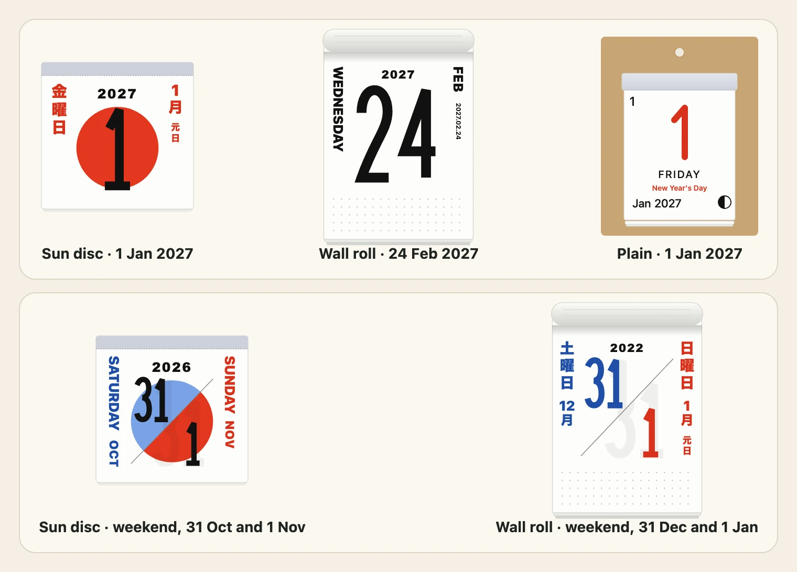
</picture>
</p>

| Cell | Where it comes from |
| --- | --- |
| The day, the month and the weekday (English or Japanese, by `locale`) | the date. The weekday needs a year, so without one the weekday cell is left empty. |
| The colour of the day (`roll`, and the weekday cells of `sun` and `plain`) | Saturday blue, Sunday and a holiday red, every other day black. |
| A holiday name | the `holidays` option, or computed with `japanese` (2000 to 2099, [the Japanese calendar](japanese-calendar.md)). |
| The moon (`plain`) | `calendarMoon`, a mean lunation from a known new moon: it can be a day out near the turn of a phase. It needs a year. `moon: false` leaves it off. |
| The old-calendar date and the six-day cycle (rokuyō) | computed with `japanese` (1900 to 2100): [the Japanese calendar](japanese-calendar.md) says how and when a cell stays empty. |

```js
import { calendarIcon } from "@johnmorrisdotca/meigen-sports";

const holidays = { "01-01": { en: "New Year's Day", ja: "元日" } };
const sun = calendarIcon({ theme: "sun", month: 1, day: 1, year: 2027, locale: "ja", holidays });
console.log(sun.includes("元")); // true
console.log(calendarIcon({ theme: "sun", month: 1, day: 1, year: 2027, locale: "ja" }).includes("元")); // false
console.log(calendarIcon({ theme: "roll", month: 1, day: 1, year: 2027, columns: false }).includes('data-part="side"')); // false
```

A `holidays` key is a date (`"2027-01-01"`) or a day of every year (`"01-01"`), and its value is one string or one string for each of `en` and `ja`. `columns: false` leaves the side columns off.

### The disc is a slot

The red disc of `sun` can be replaced by any mark: pass `mark`, SVG shapes drawn in a box from -100,-100 to 100,100 centred behind the day. It is your own markup and is written as given, so a script, a style, an event attribute, a `javascript:` address or a foreign object is refused with a `RangeError`.

```js
import { calendarIcon } from "@johnmorrisdotca/meigen-sports";

const mark = '<circle r="92" fill="#1b4ea8"/><path d="M-50 40L0-60 50 40Z" fill="#ffffff"/>';
const svg = calendarIcon({ theme: "sun", month: 3, day: 20, year: 2026, mark });
console.log(svg.includes("#1b4ea8")); // true
```

### The weekend page

`weekend: "split"` on `sun` and `roll` draws a Saturday and the Sunday after it on one page, cut by a diagonal from the top right to the bottom left: the Saturday upper left in blue, the Sunday lower right in red, each over a faint ghost of the other, and one side column each (weekday, month, holiday) in its own colour. Either day of the weekend draws the same page, a weekend that crosses a month or a year end is one page, and every other day keeps its own page: a Monday holiday, a day with no year, and any theme but `sun` and `roll`.

`calendarWeekend(year, month, day)` says which two dates a page covers, or `null`.

```js
import { calendarIcon, calendarWeekend } from "@johnmorrisdotca/meigen-sports";

console.log(JSON.stringify(calendarWeekend(2022, 12, 31))); // {"saturday":{"year":2022,"month":12,"day":31},"sunday":{"year":2023,"month":1,"day":1}}
console.log(calendarWeekend(2026, 11, 2)); // null
const page = calendarIcon({ theme: "roll", month: 10, day: 31, year: 2026, weekend: "split" });
console.log(page === calendarIcon({ theme: "roll", month: 11, day: 1, year: 2026, weekend: "split" })); // true
console.log(page.includes("Saturday Oct 31 2026 and Sunday Nov 1 2026")); // true
```

`calendarMoon(year, month, day)` is the phase of the moon in eighths of a lunation (0 new, 4 full).

```js
import { calendarMoon } from "@johnmorrisdotca/meigen-sports";

console.log(calendarMoon(2026, 11, 9), calendarMoon(2026, 11, 24)); // 0 4
```

The demo has a switch for it (`?icon=roll&weekend=split`): with it on, a weekday shows the weekend that follows. The Japanese holiday names the demo passes in are an example of `holidays`.

## Earlier names

The ten themes of 0.12 and 0.13 are still accepted. Each name reads as the theme that replaced it (`CALENDAR_THEME_ALIASES`), and `calendarThemeOf("classic")` returns `pins`.

| Earlier | Now |
| --- | --- |
| `classic` | `pins` |
| `outline` | `line` |
| `spiral` | `loops` |
| `bold` | `heavy` |
| `tent` | `flip` |
| `curl` | `curl` |
| `pad` | `stack` |
| `minimal` | `thin` |
| `fold` | `frame` |
| `tile` | `badge` |

## In a page

The `.meigen-cal` box makes the drawing as wide as its box. The stylesheet is optional.

```js no-run
import { calendarIcon } from "@johnmorrisdotca/meigen-sports";
import "@johnmorrisdotca/meigen-sports/styles.css";

document.body.innerHTML = `<span class="meigen-cal" style="width:96px">${calendarIcon({
  theme: "pins",
  month: 3,
  day: 20,
  year: 2026,
  locale: "en",
  scheme: "light",
})}</span>`;
```

Pass the month (1–12), the day (1–31) and an optional year. The library does not read the clock. `scheme` is `light` or `dark`; `size` is the width in pixels (16 to 1024) and the height follows the theme's shape. `calendarThemeOf(name)` returns a theme id, reads an earlier name as its replacement and returns `null` for anything else.

The demo keeps the choice in the address: `?icon=pins`.
