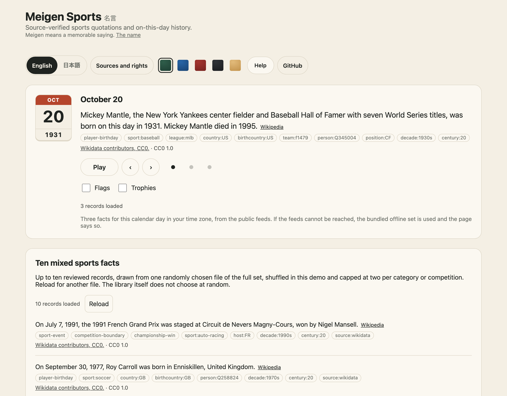
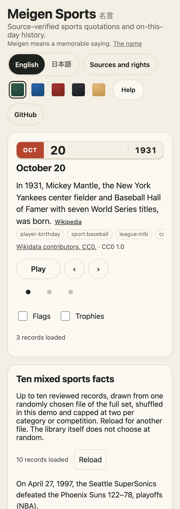
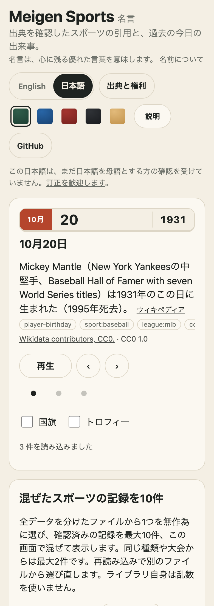
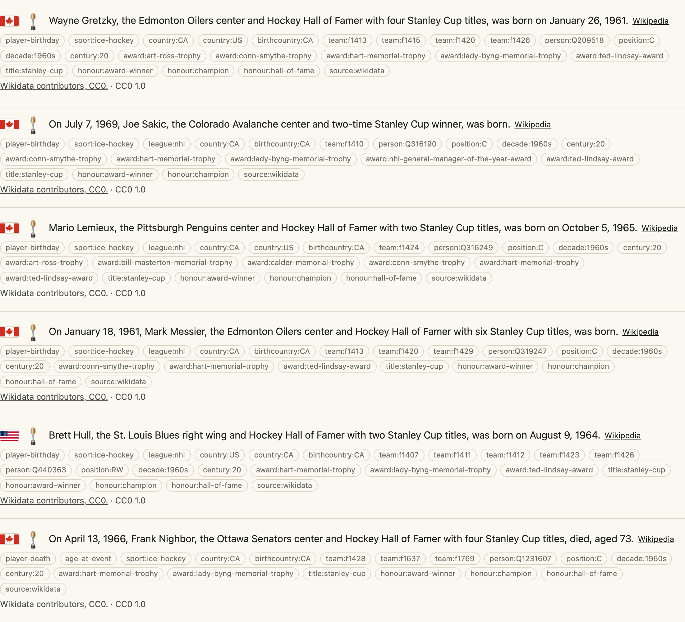

# The demo

The demo is at <https://johnmorrisdotca.github.io/meigen-sports/>: today's facts as a calendar card, ten mixed facts, the showcase, favourites by sport, league, tag, country, decade, award, honour, years, a club or a person picked by name, and a day, with a flag and a trophy beside a fact when you ask (`?flags=1&trophies=1`), and a date, sport and source picker for a quotation and the facts of any day, in English and Japanese. Its pictures:

<table align="center">
<tr>
<td align="center" valign="top">
 <em>On a phone</em>
</td>
<td align="center" valign="top">
 <em>In Japanese</em>
</td>
</tr>
</table>

 <em>A flag and a trophy beside each fact (<code>?flags=1&amp;trophies=1</code>).</em>

Every choice in the favourites is in the address (`?country=RO&decade=1990s&person=Q209518&day=1`), so a view can be sent. The flag is drawn only where the data says it is unambiguous (`flagOf`) and [Hata](https://github.com/johnmorrisdotca/hata) has it; the trophy is the very trophy where [Dougu Sports](https://github.com/johnmorrisdotca/dougu-sports) has a likeness and its plain cup where it has none ([which, in docs/tags.md](./tags.md#trophies)). Both are devDependencies of the demo: the library imports neither.
