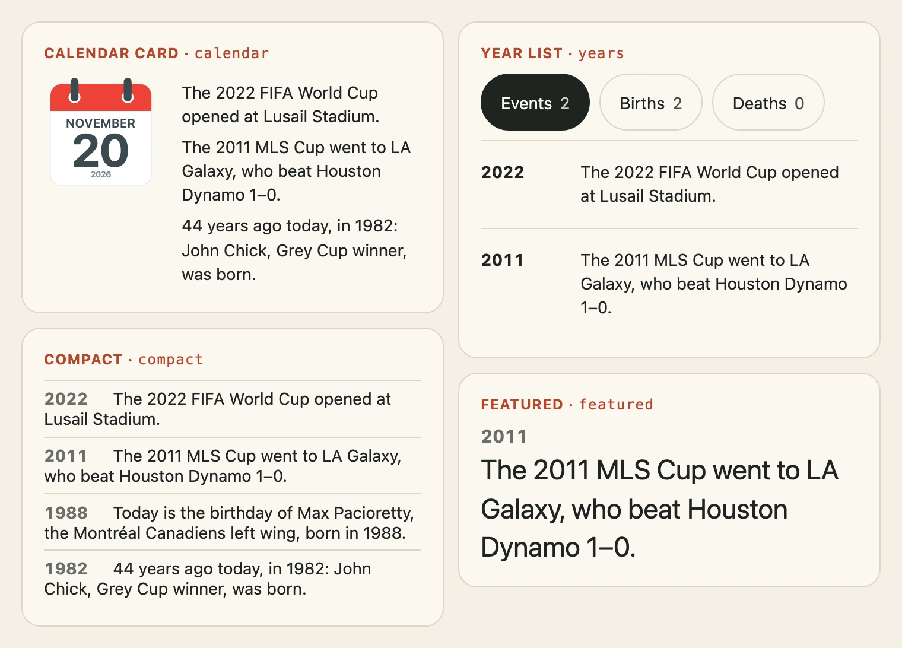
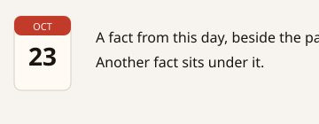
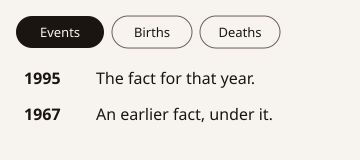
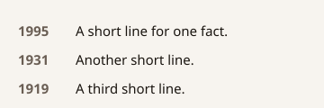
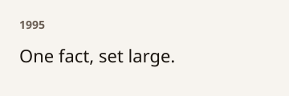
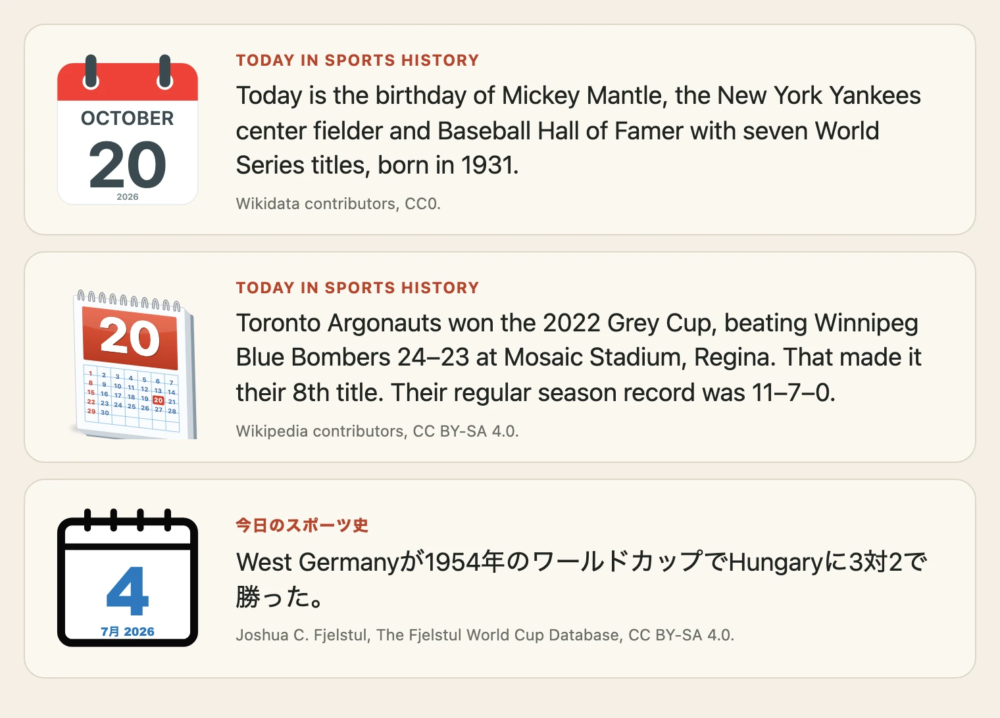
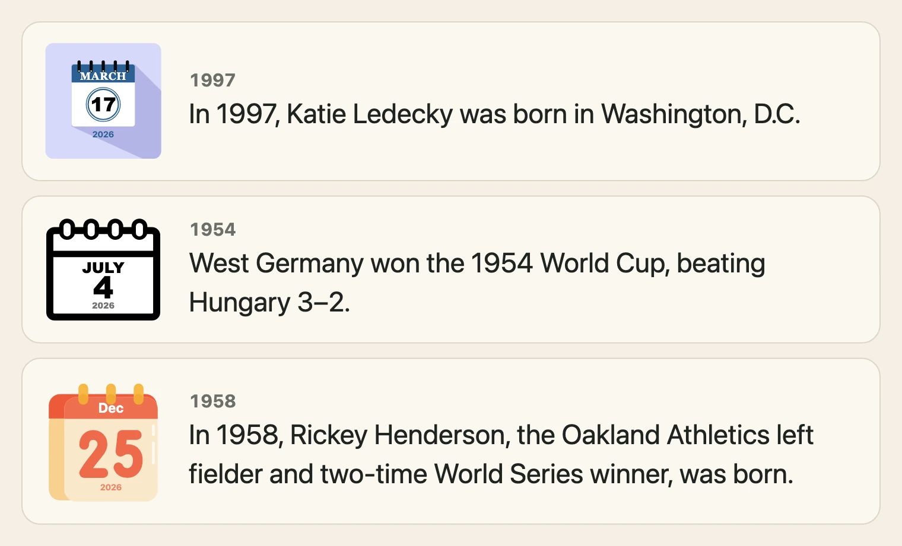
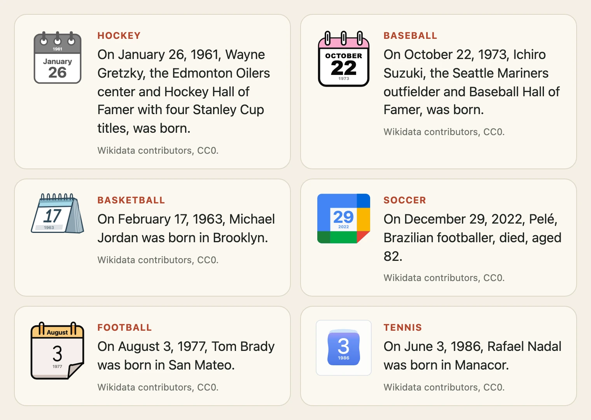

# Display layouts

[Calendar icons](calendar-icons.md) · [Gallery](calendar-gallery.md)

<p align="center">
<picture>
<source media="(prefers-color-scheme: dark)" srcset="./images/layouts-dark.webp">

</picture>
</p>

```js
import { DISPLAY_LAYOUTS, calendarIcon, displayMarkup } from "@johnmorrisdotca/meigen-sports";

const items = [
  { text: "The 2022 FIFA World Cup opened at Lusail Stadium.", year: "2022", kind: "event" },
  { text: "The 2011 MLS Cup went to LA Galaxy, who beat Houston Dynamo 1–0.", year: "2011", kind: "event" },
];
const icon = calendarIcon({ theme: "pins", month: 11, day: 20, year: 2026 });
const html = DISPLAY_LAYOUTS.map((layout) => displayMarkup({ layout, icon, items }));
console.log(html.map((one) => one.includes("meigen-layout")).join(" ")); // true true true true
console.log(html[0].includes("meigen-cal"), html[3].includes("The 2022 FIFA")); // true true
```

Four ways to show facts that are already worded. `displayMarkup` returns HTML. It does not read the clock and it does not write a sentence. Colours come from `@johnmorrisdotca/meigen-sports/styles.css`, which follows the page (`--ink`, `--muted`, `--surface`, `--rule`, `--accent`). The stylesheet is optional.

`displayMarkup(options)` takes:

| Option | Meaning |
| --- | --- |
| `layout` | one of `DISPLAY_LAYOUTS` |
| `items` | the facts to show, each a `DisplayItem`: `text` (already worded), `year` and `kind` |
| `icon` | an SVG from `calendarIcon`, used by the calendar layout; anything else is ignored |
| `labels` | the words for the three groups of the year list (`events`, `births`, `deaths`) |
| `name` | makes the year list's radio group unique when more than one is on a page |

`displayLayoutOf(name)` turns a word into a layout or `null`, and `displayKind(category)` says whether a fact is a birth, a death or an event.

| Id | English | Japanese | Picture |
| --- | --- | --- | --- |
| `calendar` | Calendar card | 日付カード |  |
| `years` | Year list | 年の一覧 |  |
| `compact` | Compact | 短い一覧 |  |
| `featured` | Featured | 一つを大きく |  |

The year list groups facts into Events (出来事), Births (誕生) and Deaths (死去). A birthday is `player-birthday`, a death is `player-death`, and every other category is an event. Years run newest first, and the compact list is in the same order (a fact with no year goes last). The featured layout keeps the first fact only.

```js no-run
import { calendarIcon, displayMarkup } from "@johnmorrisdotca/meigen-sports";
import "@johnmorrisdotca/meigen-sports/styles.css";

const icon = calendarIcon({ theme: "pins", month: 10, day: 23, year: 1995 });
document.body.innerHTML = displayMarkup({
  layout: "calendar",
  icon,
  items: [{ text: "On October 23, 1995, a match was played.", year: "1995", kind: "event" }],
});
```

The demo keeps the choice in the address: `?layout=calendar`, `?layout=years`, `?layout=compact` or `?layout=featured`. With no `layout`, the page is the calendar card.

## Examples

### The same day, four ways

The picture at the top is these four calls over the facts of 20 November. Each layout reads only what it needs: the calendar card is the only one that draws the icon, the year list is the only one that groups, and the featured layout keeps the first fact.

### Another theme in the card

Any theme can sit in the card. `displayMarkup` takes the SVG as a string, so a theme chosen at run time is one argument.

<p align="center">
<picture>
<source media="(prefers-color-scheme: dark)" srcset="./images/today-dark.webp">

</picture>
</p>

```js
import { CALENDAR_THEMES, calendarIcon, displayMarkup } from "@johnmorrisdotca/meigen-sports";

const cards = CALENDAR_THEMES.map((theme) =>
  displayMarkup({ layout: "calendar", icon: calendarIcon({ theme, month: 10, day: 20, year: 2026 }), items: [{ text: "A fact" }] }),
);
console.log(cards.length, cards.every((card) => card.includes("meigen-cal"))); // 18 true
```

### Banners

A banner is an icon beside the featured layout. The stylesheet has no banner class, so the row is two lines of your own CSS, and the featured layout inside it is unchanged.

<p align="center">
<picture>
<source media="(prefers-color-scheme: dark)" srcset="./images/banners-dark.webp">

</picture>
</p>

```js
import { calendarIcon, displayMarkup } from "@johnmorrisdotca/meigen-sports";

const icon = calendarIcon({ theme: "shadow", month: 3, day: 17, year: 2026, size: 100 });
const featured = displayMarkup({ layout: "featured", items: [{ text: "29 years ago today, in 1997: Katie Ledecky, American Olympic swimmer, was born.", year: "1997" }] });
const banner = `<div style="display:flex;gap:1.5rem;align-items:center"><div class="meigen-cal" style="width:100px;flex:none">${icon}</div>${featured}</div>`;
console.log(banner.includes("meigen-featured"), banner.includes("1997")); // true true
```

### Facts by sport

Filter the day first, word the facts, then lay them out. `sports` takes the sport codes of the facts.

<p align="center">
<picture>
<source media="(prefers-color-scheme: dark)" srcset="./images/sports-dark.webp">

</picture>
</p>

```js
import { calendarIcon, displayMarkup, factsFor, renderRun } from "@johnmorrisdotca/meigen-sports";
import offline from "@johnmorrisdotca/meigen-sports/offline";

const baseball = factsFor(offline, { date: "10-20", sports: ["baseball"] });
const words = renderRun(baseball.slice(0, 1), { seed: "sport", locale: "en", asOf: "2026-10-30" });
const card = displayMarkup({ layout: "calendar", icon: calendarIcon({ theme: "cartoon", month: 10, day: 20, year: 1931 }), items: words.map((one) => ({ text: one.text })) });
console.log(baseball.length, baseball[0]?.sport); // 5 baseball
console.log(card.includes("Mickey Mantle")); // true
```

### Labels in another language

The year list's three group names are `labels`; the facts' own wording comes from `renderRun` with `locale`.

```js
import { displayMarkup } from "@johnmorrisdotca/meigen-sports";

const html = displayMarkup({ layout: "years", labels: { events: "出来事", births: "誕生", deaths: "死去" }, items: [{ text: "A fact", year: "1995", kind: "birth" }] });
console.log(html.includes("誕生"), html.includes("meigen-count")); // true true
```

