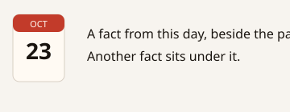
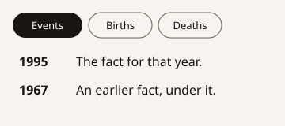
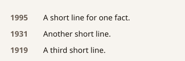
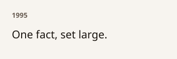

# Display layouts

Four ways to show facts that are already worded. `displayMarkup` returns HTML. It does not read the clock and it does not write a sentence. Colours come from `@johnmorrisdotca/meigen-sports/styles.css`, which follows the page (`--ink`, `--muted`, `--surface`, `--rule`, `--accent`). The stylesheet is optional.

| Id | English | Japanese | Picture |
| --- | --- | --- | --- |
| `calendar` | Calendar card | 日付カード |  |
| `years` | Year list | 年の一覧 |  |
| `compact` | Compact | 短い一覧 |  |
| `featured` | Featured | 一つを大きく |  |

The year list groups facts into Events (出来事), Births (誕生) and Deaths (死去). A birthday is `player-birthday`, a death is `player-death`, and every other category is an event. Years run newest first. The featured layout keeps the first fact only.

```js no-run
import { calendarIcon, displayMarkup } from "@johnmorrisdotca/meigen-sports";
import "@johnmorrisdotca/meigen-sports/styles.css";

const icon = calendarIcon({ theme: "classic", month: 10, day: 23, year: 1995 });
document.body.innerHTML = displayMarkup({
  layout: "calendar",
  icon,
  items: [{ text: "On October 23, 1995, a match was played.", year: "1995", kind: "event" }],
});
```

The demo keeps the choice in the address: `?layout=calendar`, `?layout=years`, `?layout=compact` or `?layout=featured`. With no `layout`, the page is the calendar card.
