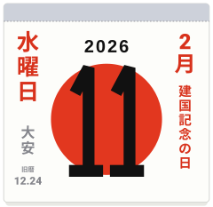
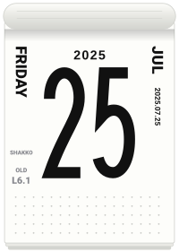

[English](japanese-calendar.md) · 日本語

# 日本のこよみをページに

日めくりカレンダーが日付のそばに印刷する事実を、3つの関数で求め、`sun` と `roll` のページの左右の欄に描けます。どれも日付だけから計算します。時計も通信も保存した表も使いません。方法で決められない日付は `null` になり、欄は空のままです。推測はしません。

<p align="center">


</p>

```js
import { calendarIcon, japaneseHoliday, oldCalendarDate, rokuyoOf } from "@johnmorrisdotca/meigen-sports";

console.log(japaneseHoliday(2026, 9, 22)?.ja); // 国民の休日
console.log(oldCalendarDate(2023, 1, 22)); // { month: 1, day: 1, leap: false }
console.log(oldCalendarDate(2025, 7, 25)); // { month: 6, day: 1, leap: true }
console.log(rokuyoOf(2023, 1, 22)?.ja); // 先勝
console.log(oldCalendarDate(2028, 1, 26)); // null
// 2028年1月26日は、新月が日本時間の午前0時12分なので、上の答えは null です。
const page = calendarIcon({ theme: "sun", month: 2, day: 11, year: 2026, locale: "ja", japanese: true });
console.log(page.includes("data-part=\"side\"")); // true
```

## 国民の祝日

`japaneseHoliday(year, month, day)` は、その日の祝日を英語と日本語で返します。祝日でなければ `null` です。`japaneseHolidaysOf(year)` は、その年の祝日を日付順に並べます。対象は2000年から2099年だけです（`JAPANESE_HOLIDAY_YEARS`）。2000年より前は決まりが違うので、ここには書いていません。

- **法律。** 国民の祝日に関する法律（昭和23年法律第178号）と、その改正です。ハッピーマンデー（成人の日は2000年から、海の日と敬老の日は2003年から）、昭和の日とみどりの日（2007年）、山の日（2016年）、2019年の皇位継承（5月1日の天皇の即位の日と10月22日の即位礼正殿の儀の行われる日。天皇誕生日は2020年から12月23日が2月23日に）、スポーツの日（2020年）、2020年と2021年の東京五輪に伴う移動（海の日、スポーツの日、山の日）を含みます。
- **春分の日と秋分の日。** 国立天文台が1980年から2099年について公表している式を使います。国立天文台は各年の日を前年の2月に発表するので、先の年は予測です。
- **振替休日と国民の休日。** 日曜日の祝日には振替休日があります。2007年からは「次の祝日でない日」、それ以前は月曜日です。祝日にはさまれた日曜日でない日は国民の休日です（2026年9月22日、2019年4月30日と5月2日）。どちらも法律の規定どおりに求めます。
- **将来の法律。** 先の年には、2026年11月時点の法律が続くと仮定します。改正があれば、保存した表ではなくコードを直します。`test/japanese-calendar.test.ts` は、2019年から2026年を内閣府の一覧と照らします。

## 旧暦

`oldCalendarDate(year, month, day)` は、旧暦（太陰太陽暦）の日付 `{ month, day, leap }` を返します。対象は1900年から2100年です（`OLD_CALENDAR_YEARS`）。

- **決まり。** 月は、新月を含む日本標準時（UTC+9）の日から始まります。冬至を含む月が11月です。ほかの月は、含む中気（太陽の黄経が0度、30度、…、330度になる時）の番号で数えます。13か月ある年では、中気を含まない最初の月が閏月で、前の月の番号になります。
- **天文計算。** 新月はミーウスの式（Astronomical Algorithms 第2版、1998年、第49章）、太陽の見かけの黄経は第25章（精度は約0.01度、時間にして10から15分）、地球時と世界時の差はエスペナクとミーウスの多項式です。
- **推測せず空にする場合。** 日付のそばで新月が日本時間の午前0時の前後30分以内にあるとき、または、中気が午前0時の前後30分以内にあって2つの月のどちらにも入りうるときは `null` です。2028年1月26日の新月は協定世界時の15時12分で、日本では27日の午前0時12分です（中国では26日で、暦が異なります）。
- **照合したもの。** 2020年から2026年、2029年、2030年、2000年の旧正月（1月1日）、2020年（閏4月）、2023年（閏2月）、2025年（閏6月）の閏月、2023年から2026年の旧暦7月7日です。また、1901年から2099年で、旧正月は1月21日から2月20日の間に入り、19年のうち約7年に閏月があることも確かめています。

## 六曜

`rokuyoOf(year, month, day)` は、（旧暦の月＋旧暦の日）を6で割った余りで決まる六曜です。閏月の月の数は、前の月と同じとします。`ROKUYO` は6つを順に並べ、それぞれ `ja`、読み（`reading`）、英語の説明を持ちます。

| 番号 | 六曜 | 読み |
| --- | --- | --- |
| 0 | 大安 | たいあん |
| 1 | 赤口 | しゃっこう |
| 2 | 先勝 | せんしょう |
| 3 | 友引 | ともびき |
| 4 | 先負 | せんぶ |
| 5 | 仏滅 | ぶつめつ |

1月1日は必ず先勝、2月1日は友引です。以降、番号2から順に進みます。

## 左右の欄に描く

`calendarIcon` の `japanese` を `true` にすると3つとも描き、`{ holidays, oldDate, rokuyo }` で選ぶこともできます。初期値はオフなので、指定しなければこれまでどおりです。祝日は右の欄に赤で、六曜と旧暦の日付は左の欄の下に小さく灰色で描きます（`holidays` に名前があれば、そちらが優先です）。旧暦の日付は「旧暦」の下に月と日を書き、閏月は「閏」を付けます。土日ページでは祝日だけです。デモのスイッチは `?jp=1` です。
