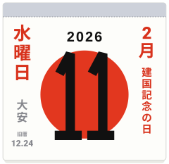
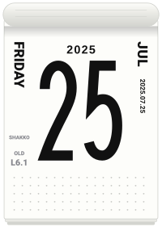

[日本語](japanese-calendar.ja.md) · English

# The Japanese calendar on a page

Three functions give the facts a Japanese tear-off calendar prints beside the day, and two side columns of the `sun` and `roll` pages can draw them. All three are computed from the date: no clock, no network, no stored table. A date the method cannot settle gives `null` and an empty cell, never a guess.

<p align="center">


</p>

```js
import { calendarIcon, japaneseHoliday, oldCalendarDate, rokuyoOf } from "@johnmorrisdotca/meigen-sports";

console.log(japaneseHoliday(2026, 9, 22)?.en); // Citizens' Holiday
console.log(oldCalendarDate(2023, 1, 22)); // { month: 1, day: 1, leap: false }
console.log(oldCalendarDate(2025, 7, 25)); // { month: 6, day: 1, leap: true }
console.log(rokuyoOf(2023, 1, 22)?.reading); // Senshō
console.log(oldCalendarDate(2028, 1, 26)); // null
// 26 January 2028: the new moon is twelve minutes after midnight in Japan, so the answer is null above.
const page = calendarIcon({ theme: "sun", month: 2, day: 11, year: 2026, locale: "ja", japanese: true });
console.log(page.includes("data-part=\"side\"")); // true
```

## Public holidays (kokumin no shukujitsu)

`japaneseHoliday(year, month, day)` returns the holiday of a day in English and Japanese, or `null`; `japaneseHolidaysOf(year)` lists a year's, in date order. Years 2000 to 2099 only (`JAPANESE_HOLIDAY_YEARS`): the rules before 2000 differ and are not written down here.

- **The law.** The Act on National Holidays (Kokumin no shukujitsu ni kansuru hōritsu, Act No. 178 of 1948) as amended: the Happy Monday changes (Coming of Age Day from 2000, Marine Day and Respect for the Aged Day from 2003), Showa Day and Greenery Day (2007), Mountain Day (2016), the imperial succession of 2019 (Accession Day on 1 May and the Enthronement Ceremony Day on 22 October of 2019, the Emperor's Birthday moved from 23 December to 23 February from 2020), Sports Day (2020) and the Olympic moves of 2020 and 2021 (Marine Day, Sports Day and Mountain Day).
- **Equinoxes.** Vernal and Autumnal Equinox Day use the formula the National Astronomical Observatory of Japan publishes for 1980 to 2099. The Observatory announces the day of each year in February of the year before, so a day far ahead is its prediction.
- **Substitute holidays and Citizens' Holidays.** A holiday on a Sunday gives a Substitute Holiday: the next day that is not a holiday (since 2007; before it, the Monday). A day between two holidays that is not a Sunday is a Citizens' Holiday (22 September 2026, 30 April and 2 May 2019). Both are derived by the Act's own rules.
- **Later law.** The law in force in November 2026 is assumed for the years after; an amendment changes the code, not a stored list. `test/japanese-calendar.test.ts` holds 2019 to 2026 to the Cabinet Office's lists.

The names in English: New Year's Day, Coming of Age Day, National Foundation Day, Emperor's Birthday, Vernal Equinox Day, Showa Day, Constitution Memorial Day, Greenery Day, Children's Day, Marine Day, Mountain Day, Respect for the Aged Day, Autumnal Equinox Day, Sports Day (Health and Sports Day before 2020), Culture Day, Labor Thanksgiving Day, Substitute Holiday, Citizens' Holiday, Accession Day and Enthronement Ceremony Day. The Japanese names are on [the Japanese page](japanese-calendar.ja.md) and in `japaneseHoliday(...).ja`.

## The old calendar (kyūreki)

`oldCalendarDate(year, month, day)` returns `{ month, day, leap }`, the date in the old lunisolar calendar, for 1900 to 2100 (`OLD_CALENDAR_YEARS`).

- **The rule.** A month starts on the Japan Standard Time (UTC+9) date of the new moon. The month that holds the winter solstice is the 11th. Every other month is numbered by the principal term (chūki: the sun's longitude at 0°, 30°, ... 330°) it holds. In a year of thirteen months the first month with no principal term is the leap month (uruu-zuki), and it takes the number of the month before it.
- **The astronomy.** The new moon is Meeus's (Astronomical Algorithms, second edition, 1998, chapter 49), the sun's apparent longitude his chapter 25 (about 0.01°, ten to fifteen minutes), the difference between terrestrial and universal time the Espenak and Meeus polynomials.
- **Left empty rather than guessed.** A new moon within 30 minutes of midnight in Japan, next to the date, or a principal term within 30 minutes of midnight that could fall in either of two months, gives `null`. The new moon of 26 January 2028 is at 15:12 UTC: 12 minutes after midnight on the 27th in Japan (it is the 26th in China, whose calendar differs there).
- **Checked against** the published new year (the first of the first month) of 2020 to 2026, 2029, 2030 and 2000, the leap months of 2020 (4th), 2023 (2nd) and 2025 (6th), the seventh of the seventh month of 2023 to 2026, and, over 1901 to 2099, that the new year falls between 21 January and 20 February and about seven years in nineteen have a leap month.

## The six-day cycle (rokuyō)

`rokuyoOf(year, month, day)` is the word of the day by (old month + old day) modulo 6, the month number of a leap month being that of the month before it. `ROKUYO` lists the six in order; each has `ja`, a `reading` and an English gloss.

| Index | Reading | English gloss |
| --- | --- | --- |
| 0 | Taian | very lucky |
| 1 | Shakkō | unlucky except at noon |
| 2 | Senshō | lucky in the morning |
| 3 | Tomobiki | friends pulled along |
| 4 | Senbu | lucky in the afternoon |
| 5 | Butsumetsu | unlucky |

The first of the first month is always Senshō, the first of the second month Tomobiki, and so on in this order from the third index.

## In the side columns

`calendarIcon` has an option `japanese`: `true` draws all three, or `{ holidays, oldDate, rokuyo }` chooses. It is off by default, so a page drawn without it is as it was. The holiday is red in the right column (a name in the `holidays` option wins); the six-day word and the old calendar date are small and grey at the foot of the left column, the date as `OLD 12.24` over its month and day (`L` before a leap month; in Japanese the old-calendar label, with the leap mark before the month). A weekend page shows the holiday only. The demo's switch is `?jp=1`.
