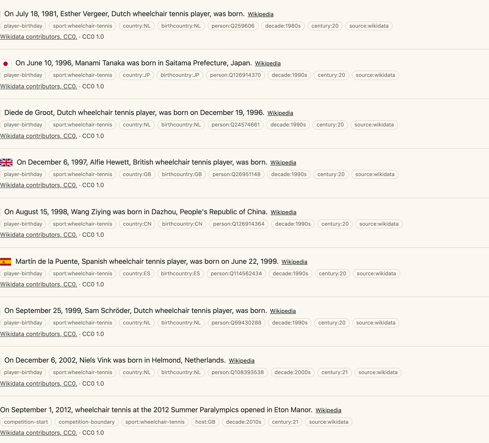

[日本語](para-sports.ja.md) · English

# Para sports: wheelchair sports, goalball, boccia and the Paralympic Games

Generated by `python3 -I pipeline/coverage_para.py`. Do not edit the numbers by hand.

The package holds **961 facts of para sports** in 29 sports: 533 births and 116 deaths of people, 133 starts and 134 ends of editions, and 45 single days. They come from the Wikidata dump of 2026-10-12 (`wikidata-20261012-all.json.gz`, CC0, each fact with its Q id) through `pipeline/wikidata_dump_para.py`, which reads the same filtered files as the dump of people and events and writes one extract. Nothing is fetched, so the pass makes no request.

 <em>A para sport in the demo (<code>?sport=wheelchair-tennis</code>).</em>

## What is stored: the sport's name and nothing else about the body

John's decision of 2026-11-02: the sport itself may be named (`wheelchair-basketball`, `goalball`, `boccia`, `para-swimming`, `paralympics`). Never stored, in any field, sentence, tag or name:

- a class code (T54, F42, S9, SB5, BC1, SH6, PR2, WH1 and the like), or the word for a class, a category or a classification;
- an impairment, a diagnosis or any other statement about health or the body;
- the person's own Wikidata description (free text): a person is called by a phrase of a fixed table, a nationality word and the sport ("Dutch wheelchair tennis player", "goalball player").

An event whose name holds a class code or a word for the body is left out. So are Games and bodies set up for a condition and not a sport (the Invictus Games, the Special Olympics, the Deaflympics, IBSA, INAS, CP-ISRA, IWAS), and a sport whose name states an impairment (blind, deaf, amputee). `test/para-sports.test.ts` and the golden rule `para-facts-name-the-sport-only` fail on a class code or a health word in any para fact, and `pipeline/test_wikidata_dump_para.py` holds the extractor to the same.

## Who is published

The dump rule (30 Wikipedia editions) would publish nobody here: the best-linked player has 28. A person is published when any one of these is true (the counts are of people with a birth or death fact: 551 people):

- **listed** (17): he is on John's priority list or the 2,000 list;
- **medallist** (170): a Paralympic medal (a medal statement, or a first, second or third place at a Paralympic Games), a world or Paralympic champion title or any Hall of Fame, with at least 1 Wikipedia edition (an article);
- **deceased** (115): Wikidata holds a death and he has an English Wikipedia article;
- **veteran** (192): he took part in 4 or more Paralympic Games and has 3 or more editions (an exceptional career);
- **celebrity** (57): 10 or more editions (a public figure by the count the package ranks by everywhere).

A living person who is none of these is not published. A world record is not in the filtered files, so nobody is chosen by a record alone (left to revisit). A date is used only at day precision on the Gregorian calendar, from 1850, and never on January 1.

## Events

An event is published when it has a day-precision date, a name and at least 1 Wikipedia edition: a Paralympic Games edition, a sport at a Games, a world or regional championship, a tournament. A start, an end and a single day are three kinds of fact, as for the other events. The place and the winner are said only where Wikidata states them; a national team is named by its country ("won by Canada"), and no person is named as the winner of an event whose name carries a sex marker.

## By sport

| Sport | Facts | Births | Deaths | Starts | Ends | Single days |
| --- | ---: | ---: | ---: | ---: | ---: | ---: |
| `para-athletics` | 229 | 163 | 43 | 10 | 10 | 3 |
| `paralympics` | 97 | 0 | 0 | 47 | 47 | 3 |
| `para-badminton` | 79 | 34 | 0 | 22 | 23 | 0 |
| `wheelchair-tennis` | 77 | 51 | 4 | 11 | 11 | 0 |
| `para-swimming` | 67 | 48 | 14 | 2 | 2 | 1 |
| `para-table-tennis` | 49 | 33 | 13 | 1 | 1 | 1 |
| `para-alpine-skiing` | 46 | 28 | 4 | 0 | 0 | 14 |
| `wheelchair-curling` | 39 | 24 | 11 | 2 | 2 | 0 |
| `para-judo` | 38 | 13 | 0 | 12 | 12 | 1 |
| `wheelchair-basketball` | 34 | 14 | 10 | 4 | 4 | 2 |
| `para-powerlifting` | 28 | 22 | 2 | 0 | 0 | 4 |
| `para-rowing` | 19 | 3 | 0 | 8 | 8 | 0 |
| `wheelchair-fencing` | 19 | 17 | 2 | 0 | 0 | 0 |
| `boccia` | 15 | 10 | 3 | 1 | 1 | 0 |
| `para-taekwondo` | 15 | 14 | 0 | 0 | 0 | 1 |
| `para-ice-hockey` | 14 | 9 | 3 | 1 | 1 | 0 |
| `sitting-volleyball` | 13 | 8 | 1 | 1 | 1 | 2 |
| `para-snowboard` | 12 | 8 | 1 | 0 | 0 | 3 |
| `para-cycling` | 10 | 3 | 1 | 3 | 3 | 0 |
| `para-biathlon` | 9 | 3 | 0 | 0 | 0 | 6 |
| `standing-volleyball` | 9 | 4 | 3 | 1 | 1 | 0 |
| `wheelchair-rugby` | 9 | 5 | 0 | 2 | 2 | 0 |
| `goalball` | 8 | 2 | 0 | 2 | 2 | 2 |
| `para-archery` | 5 | 2 | 1 | 1 | 1 | 0 |
| `para-equestrian` | 5 | 5 | 0 | 0 | 0 | 0 |
| `wheelchair-racing` | 5 | 5 | 0 | 0 | 0 | 0 |
| `para-climbing` | 4 | 0 | 0 | 2 | 2 | 0 |
| `para-shooting` | 4 | 4 | 0 | 0 | 0 | 0 |
| `para-cross-country-skiing` | 3 | 1 | 0 | 0 | 0 | 2 |
| **All** | **961** | **533** | **116** | **133** | **134** | **45** |

## Read and left out, with the counts of the last build

- Read: 5,466 people in a para sport
- 2,888 left out: not famous by the para rule (not listed, no medal or title, not deceased with an English article, under 4 Games, under 10 editions)
- 1,983 left out: no Gregorian day-precision birth or death
- Read: 1,891 events in a para sport
- 1,065 left out: the name holds a class code or a health word
- 511 left out: no usable day (day precision, Gregorian, not January 1 or December 31)
- 77 left out: a season, a play-off, a story about an event, or a name that says today
- 70 left out: no usable English name
- 11 left out: no Wikipedia article
- 10 left out: the year in the name is not the year of the date
- 8 left out: Games for people chosen by a condition, not a sport
- 3 left out: a multi-sport event that only includes a para sport
- 1 left out: dates do not agree (death before birth, or past 115 years)

## Left to revisit

- People of the sports above who are not famous by the rule are not published (2,888 in the dump): a Wikipedia list of Paralympic medallists (CC BY-SA 4.0, read like the Olympic one) would add medallists whose Wikidata item has no medal statement.
- Records (a world or Paralympic record) are not in the filtered dump files; a record needs a new read of the record statements.
- Events with a class code or a word for the body in the name are left out (1,065); a version of them without the class would need the discipline's own page, not the class page.
- Sports whose name states an impairment (blind football, amputee football), paragliding and the Deaflympics are not on the list.
- The IPC site and the federations' sites are not used: all rights reserved, no open licence found, and the IPC's `robots.txt` disallows its profiles.
